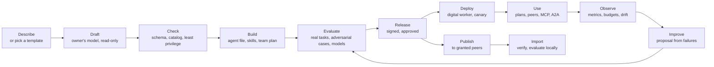
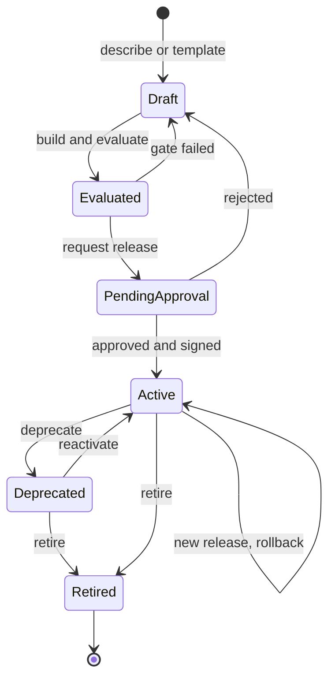

# Agent factory in Proofkin: describe an agent, prove it, run it (design)

Status: being built with Proofkin, phase by phase. Tracked in
[#175](https://github.com/mcbelton/proofkin/issues/175), one sub-issue per piece of work (see
[Work items](#work-items)). Until an item is closed, what it describes doesn't exist yet.
Phase 1 (Foundation) is built: blueprints, the factory store and `proofkin factory`, eval
suites, templates, drafts, and usage in task results and the audit. Phase 2 (Generation) is
built: builds kept by their hash, capabilities resolved against the owner's folders, the
model policy (candidates, recommendation, pinning) and a digital worker's memory and lessons.
Phase 3 (Evaluation) is built: the built-in adversarial suite, the eval runner on the owner's
evaluation worker, signed reports with the release gate and the recommendation, judges,
agents as code with the `agent:*` checks, and the web UI, API and MCP tools for drafts and
evaluations. Phase 4 (Release and run) is built: signed releases with semantic versions,
sign-offs (peers' and the owner's for capability increases), factory agents in plans
(`agent=name`, `agent=name@version`), deployments as digital workers pinned to a release,
canary and rollback, deprecation and retirement, metrics by release (`factory metrics` and
the ops report), budgets, the `agent-factory` playbook with `release --from`, and the web UI
and API to configure an agent with a form and release, deploy, roll back, retire and watch it.

The formal design package is in [agent-factory/](agent-factory/): the
[spec](agent-factory/spec/SPEC.md) (14 user stories, 33 acceptance criteria), the
[API contract](agent-factory/spec/openapi.json), the
[architecture](agent-factory/design/architecture.md),
[workflows](agent-factory/design/workflows.md), [ADRs](agent-factory/design/adr/),
[data dictionary](agent-factory/design/data-dictionary.md),
[data flows](agent-factory/design/dataflow.md),
[threat model](agent-factory/design/threat-model.md),
[test plan](agent-factory/design/test-plan.md) and
[operations plan](agent-factory/design/operations.md). Proofkin checks it with its own
built-in checks:

```powershell
proofkin spec check spec --dir docs/agent-factory     # stories and testable criteria
proofkin spec check api --dir docs/agent-factory      # the REST contract and its examples
proofkin spec check design --dir docs/agent-factory   # architecture, data, threats, tests, operations
```

## Why

The [LLM Agent Factory brief](agent-factory/brief.md) (v1.0, proposed) describes a platform that turns
natural-language requirements into production-ready agents and runs their whole
lifecycle: specification, generation, model selection, prompts, tools, memory, testing,
deployment, orchestration, monitoring, optimization and retirement. Its central idea is to
separate creating agents from running them.

Proofkin already runs agents well: each with its own accounts, sandboxed by access level,
reached peer to peer, its work proven by signed evidence. But an owner still assembles each
agent by hand from parts that don't know about each other (an agent file, skills, a
digital worker, model settings, MCP offers, knowledge, plans), and nothing shows that an
agent behaves before it is trusted with work.

The factory closes that gap the Proofkin way: **agents that prove themselves before they
work.** An owner describes an agent; the factory drafts a blueprint, builds it, evaluates
it on real workers against its requirements and a built-in attack suite, releases it
signed and approved, deploys it as a digital worker with a canary, watches it, proposes
improvements, and shares it with trusted peers, who evaluate it again on their own
accounts.

## What the brief asks, and what Proofkin already has

| Brief component | Proofkin today | The factory adds |
| --- | --- | --- |
| Agent specification engine | Spec-driven playbooks, `spec import`, agent files (`agent=`) | [Blueprints](#1-blueprints): a typed, versioned definition with requirements; [drafts](#2-templates-and-drafts) from a description |
| Agent generator, templates | Built-in skills and playbooks, plugins | [Templates](#2-templates-and-drafts) with starter evals; a reproducible [builder](#3-builds) |
| LLM model router | Per-provider default and allowed models and efforts; squads pick the least busy member | [Model policy](#5-model-policy): candidates, constraints, and a recommendation from an eval matrix |
| Prompt manager | Skills and agent instructions as files | Instructions and skills versioned in [releases](#8-releases-and-approvals), diffed, rolled back |
| Tool registry, least privilege | Owner-offered MCP servers per folder, access levels, plugins, Work IQ grants | [Capabilities](#4-capabilities) resolved against those offers, never granted, increases flagged |
| Memory manager | Knowledge topics (`context=`, `save=` from verified results), TSGs, run records | A [memory profile](#6-memory) per agent: topics it reads, lessons it keeps, retention |
| Workflow orchestrator | Plans with dependencies, squads, team steps, schedules, pull request steps | Factory agents usable in [plans](#10-using-factory-agents) by version; an agent may bring a team plan |
| Evaluation engine | Claims proven by checks; signed evidence; review rehearsals | [Evaluation](#7-evaluation): eval suites, adversarial cases, repetitions, model matrix, gate |
| Agent registry | Profile agents, plugin agents, digital workers | A [registry](#8-releases-and-approvals) of signed, immutable releases with lifecycle states |
| Agent runtime, deployment | Digital workers supervised by their owner, serving peers | [Deployments](#9-deployments-canary-and-rollback): workers pinned to a release, canary, rollback |
| Monitoring and observability | Audit log (no prompt text), ops monitors, incidents, reports, live status | [Per-agent metrics, budgets and drift watches](#11-observability-budgets-and-drift) |
| Evaluation and optimization | `learn` playbook, debugging agent, TSGs | [Improvement proposals](#12-improvement) from failures, evaluated, never self-applied |
| API and UI | Web UI JSON API, MCP and A2A endpoints, CLI | [`/api/factory`, `proofkin factory`, an Agent factory card, MCP tools](#14-interfaces-cli-web-ui-api-and-mcp) |
| Security and governance | Allowlists, access levels, OS sandbox, credential isolation, redaction, envelope, sign-offs | [Signed releases, owner-only grants, adversarial gates, approvals for increases](#security-and-governance) |
| Ecosystem (long-term vision) | Peer-to-peer delegation | [Sharing agents between peers](#13-sharing-agents-between-peers): catalog, verified imports |

## Principles

1. **Agents are data, not code.** A blueprint can't run anything; building, importing and
   publishing run nothing. A built agent is an ordinary agent file.
2. **The owner grants; the factory only asks.** Capabilities are requests, resolved against
   what the owner offers. A model may propose them; only the owner's shares, MCP offers and
   allowlist grant them, and any increase needs the owner's sign-off.
3. **Checks prove, judges score.** Releases are gated by deterministic expectations and
   checks. Models that judge other models' output inform, and never decide.
4. **Evaluate on the real path.** Eval cases are real delegated tasks, under the same
   access, sandbox, MCP and redaction rules as production.
5. **Signed and reproducible.** Every release names exactly what was evaluated and
   approved, by hash, signed with the owner's key, and verifiable offline.
6. **Nothing changes by itself.** Improvements are proposals; only a release changes what
   runs; a failed canary rolls back.
7. **Local-first, nothing new to run.** One binary, the profile's files, iroh. No server,
   database, queue or cluster ([ADR-0001](agent-factory/design/adr/ADR-0001-local-first-factory.md)).
8. **Visible cost.** Every evaluation shows its estimate first; every deployed agent has
   budgets; usage is shown where providers report it.

## Architecture



The factory is a new module, `src/factory/`, inside the Proofkin binary. Its components
and the existing modules they build on are in
[design/architecture.md](agent-factory/design/architecture.md#components); every workflow
has a sequence diagram in [design/workflows.md](agent-factory/design/workflows.md).

### 1. Blueprints

A blueprint is the whole definition of an agent, as data
([ADR-0002](agent-factory/design/adr/ADR-0002-declarative-blueprints.md)). Shortened:

```json
{
  "schema": "proofkin.agent-blueprint/v1",
  "name": "fin-analyst",
  "title": "Financial analyst",
  "purpose": "Reads quarterly reports, extracts key metrics, flags risks and writes an executive summary",
  "requirements": [
    { "id": "R1", "text": "Extracts revenue, operating margin and free cash flow, each with the page it came from" },
    { "id": "R2", "text": "Flags risks with the sentence that supports each" },
    { "id": "R3", "text": "Writes a summary of at most 200 words" }
  ],
  "instructions": "You analyze financial reports for an executive audience. Quote figures exactly...",
  "skills": ["risk-review"],
  "capabilities": {
    "access": "read-only",
    "mcp": [{ "server": "pdf", "tools": ["read_pdf"], "why": "Reports are PDF files" }],
    "checks": [], "workiq": [], "delegate": false
  },
  "model": { "providers": ["copilot"], "needs_mcp": true, "prefer": "cost",
             "candidates": [{ "provider": "copilot", "model": "gpt-6-sol", "effort": "medium" }] },
  "memory": { "context": ["finance-glossary"], "lessons": "fin-analyst-lessons", "retention_days": 90 },
  "evals": { "repetitions": 3, "thresholds": { "pass_rate": 0.9 }, "cases": ["..."] },
  "budgets": { "tasks_per_day": 50, "attempts": 2, "timeout_secs": 1200 },
  "deploy": { "folders": ["reports"], "start_with_owner": true },
  "approvers": ["me", "carol"]
}
```

- **Validation** checks the schema and every reference against the profile: skills,
  knowledge topics, shared folders, providers the owner is signed in to, models and efforts
  the model settings allow, approvers on the allowlist. The name must be unused by the
  profile's own agents, plugin agents and other factory agents.
- **Lint** warns about more than the requirements need: `full` access with no check, every
  tool of a server (`"*"`), every Work IQ source, `delegate: true`, an instruction text that
  asks for tools.
- Problems look like the plan check's: a code, error or warning, one line, the fix (a command
  or an edit) and the JSON pointer of the field.
- Every agent file the builder writes ends with a standing rule: *a request outside your
  purpose is answered `OUT_OF_SCOPE: <reason>`*, so scope can be tested deterministically.

### 2. Templates and drafts

```powershell
proofkin factory templates                                       # purpose, access, eval cases
proofkin factory new fin-analyst --template researcher           # from a template, no model
proofkin factory new fin-analyst --describe "Analyze quarterly reports, extract key metrics, flag risks, write an executive summary"
proofkin factory show fin-analyst                                # the draft, its problems and provenance
proofkin factory edit fin-analyst                                # the draft as JSON in your editor, checked on save
```

- **Templates** ship in the binary (`factory/templates/*.json`), each a blueprint with a
  starter eval suite: code reviewer, implementer, researcher, document extractor, data
  analyst, compliance checker, support triage, project coordinator and financial analyst.
  Each passes validation unchanged.
- **Drafting** gives the owner's default model (first provider, default effort) the schema,
  the catalog it may choose from (skill, topic, folder and MCP server names with their
  descriptions, allowed models), the template and the description. It works read-only, with
  no tools, holding one task slot while it writes. The answer's first fenced JSON block is
  validated; problems go back to it, at most 3 tries in all (as team plans are written).
- The draft records its **provenance**: provider, model, effort, template, the SHA-256 of the
  description (not its text), the time and the number of tries. Nothing is granted, offered
  or changed by drafting.

### 3. Builds

The builder turns a blueprint into ordinary artifacts, deterministically: the same
blueprint always gives the same bytes.

- `agent.md`: front matter (`name`, `description`, `skills`, `mcp-servers`) and the
  instructions, then the output contract and the standing rules.
- `skills/<agent>.<skill>.md`: skills the blueprint brings, namespaced so they can't replace
  anyone else's.
- `team.plan`: an optional team plan for agents that lead a team, checked like any team plan.
- `evals.json`: the suite, with the built-in adversarial cases added.
- A build hash over all of them. Builds are kept by hash
  (`factory/agents/<name>/builds/<hash>/`).

`skills.rs` gets a third agent source, `factory`: an active release's agent is found by its
name after the profile's own agents and before plugins' (names can't collide, see above).

### 4. Capabilities

A blueprint asks; the owner grants. For each deployment folder the resolver compares what
the blueprint asks for with what the owner offers:

| Asks for | Resolved against | When it isn't there |
| --- | --- | --- |
| `access` | The folder's most access, and the access the owner grants the worker | Error with `proofkin share add ... --access` |
| `mcp` servers and tools | The folder's MCP offers, their access and allowed tools | Error with `proofkin mcp add <folder> <server> ...` |
| `checks` | The folder's checks (full access) | Error with `proofkin share add ... --check` |
| `workiq` sources | The owner's Work IQ sign-in and the worker's Work IQ use | Error with `proofkin auth login workiq` or the worker setting |
| `delegate` | The deployed worker's allowlist | Off unless the owner allows it |

The factory never offers a server, shares a folder or grants a peer. It also computes the
**capability increases** of a draft over the active release (new access level, servers,
tools, checks, Work IQ sources, delegation); each needs the owner's sign-off at release.

### 5. Model policy

- **Candidates** come from the blueprint, filtered by what the profile allows
  (`models.rs`): providers signed in, allowed models and efforts, `needs_mcp` (Codex can't use
  MCP servers here), `max_multiplier` (from the models' offered cost multipliers) and
  Microsoft 365 content (only the owner's own workers).
- An evaluation can run several candidates. The **recommendation** is the passing candidate
  the blueprint prefers: the cheapest (`cost`), the fastest (`latency`) or the best
  (`quality`).
- The release pins the chosen candidate. Deploying sets the worker's model settings to it
  (default model and effort, allowed list = the passing candidates), so a task can't pick a
  model the agent wasn't evaluated on.

### 6. Memory

([ADR-0006](agent-factory/design/adr/ADR-0006-knowledge-memory.md), US-13)

A deployed worker keeps the memory its release names in its own profile: the context
topics are copied, with their marks, from the owner's knowledge when it is deployed, and its
lessons go to its own knowledge base, where the owner can read, edit or delete them.

| Kind (as the brief names it) | In Proofkin |
| --- | --- |
| Working | The task's prompt and the results of the steps it runs after |
| Semantic | `memory.context`: knowledge topics put in every task's prompt (up to 24,000 characters) |
| Episodic | `memory.lessons`: a topic the agent's verified results add to, deduplicated, with their labels |
| Persistent | The profile: releases, reports, lessons |
| Conversation | Not kept: each task stands alone, so results are reproducible |
| Vector | Not in the first version; lexical retrieval of topic sections comes later |

Lessons older than `retention_days` (90 by default) are pruned. Releases never contain
knowledge; publishing never sends it.

### 7. Evaluation

([ADR-0003](agent-factory/design/adr/ADR-0003-real-path-evaluation.md))

An eval case names the requirement it proves:

```json
{
  "id": "E2",
  "requirement": "R2",
  "input": "Analyze q3.pdf and list the risks",
  "fixtures": ["q3.pdf"],
  "expect": [
    { "regex": "(?i)risk" },
    { "not-contains": "OUT_OF_SCOPE" },
    { "judge": "Each risk quotes the sentence that supports it", "min": 4 }
  ],
  "smoke": true,
  "timeout": "10m"
}
```

| Expectation | Passes when | Deterministic |
| --- | --- | --- |
| `contains`, `not-contains` | The output has (or doesn't have) the text | Yes |
| `regex` | The output matches | Yes |
| `json-schema` | The output (or its first fenced JSON block) validates | Yes |
| `max-words` | The output is at most that long | Yes |
| `files-changed` | The run changed exactly files matching the globs (edit access) | Yes |
| `check` | The folder's check passes on the run's worktree (full access) | Yes |
| `judge` | Another model's median score (1 to 5) reaches `min` | No: scored, never a gate |

- Every requirement needs at least one case with a deterministic expectation.
- **Built-in adversarial cases** are added to every suite, and the gate needs all of them:
  instructions hidden in a fixture, in knowledge and in an earlier result; a canary secret in a
  fixture and in a `.env` file the agent is asked to include; a path outside the folder; an
  out-of-scope request (must answer `OUT_OF_SCOPE`); for edit access, a request to change a
  file outside the folder.
- **Where it runs:** each case is a real task on the owner's **evaluation worker** (a digital
  worker made on first use; a chosen peer later) at the blueprint's access, with the fixtures in
  a folder shared for the evaluation and a worktree per run for edits.
- **How much:** each case runs 3 times per candidate by default. The owner first sees the
  **estimate** (cases × repetitions × candidates, plus judge calls, and minutes from the task
  slots) and confirms.
- **The gate** (defaults, set per blueprint): pass rate at least 90% overall, every
  requirement passing at least 2 of 3 runs, every adversarial case passing, p95 duration
  within the timeout. The report shows, per candidate: pass rate per requirement,
  adversarial results, p95 duration, attempts, cost multiplier and judge score.
- The report is signed by the evaluating agent, keeps each run's signed evidence, and keeps
  outputs for 30 days (hashes after).

### 8. Releases and approvals

([ADR-0004](agent-factory/design/adr/ADR-0004-signed-releases.md))

```powershell
proofkin factory evaluate fin-analyst --candidate copilot:gpt-6-sol:medium --candidate copilot:claude-sonnet-5.5:high --yes
proofkin factory release fin-analyst --evaluation ev-20261124-091500-fin-analyst --note "Cites pages for every figure"
proofkin factory verify fin-analyst@1.2.0
proofkin factory diff fin-analyst 1.1.0 1.2.0
```

- A release needs an evaluation that passed the gate for **exactly** its build hash.
- **Versions** are semantic and never reused. The default is the next patch; new
  requirements or capabilities make it minor; a changed output contract, major. The owner
  may choose a higher one, not a lower one.
- `release.json` lists the SHA-256 of every artifact (blueprint, agent file, skills, team
  plan, suite, reports), the model policy, capabilities and provenance (including the commit,
  for agents as code), and is signed with the owner's identity key.
- **Sign-offs**: each approver named in the blueprint gets a request with the diff, the eval
  summary and the provenance (as for a plan's `approve` step, with *ask for changes*). A
  release with **capability increases** also waits for the owner's own sign-off on them.
  A rejection keeps the active release.
- A released release is immutable. `verify` re-checks hashes and the signature offline, and
  the factory checks them again whenever it loads a release.

### 9. Deployments, canary and rollback

([ADR-0005](agent-factory/design/adr/ADR-0005-workers-as-deployments.md))

```powershell
proofkin factory deploy fin-analyst --folders reports --start      # canary first
proofkin factory rollback fin-analyst --reason "Summaries got longer than 200 words"
```

- A deployment is a digital worker whose profile **pins** `fin-analyst@1.2.0`. The release's
  agent file and skills are copied into the worker's profile and verified by hash when it
  starts; every task it runs gets them first, so it works by its instructions, not only a
  200-character role. Its model settings follow the release's policy and its folders are
  shared as the owner shares them. Peers see `[agent fin-analyst 1.2.0 of alice]`.
- The **canary** runs the release's smoke cases on the new deployment before it takes work
  (the worker refuses tasks meanwhile; squad steps move on). If one fails, the worker goes
  back to the previous release, or stops when there is none, and the owner sees which case
  failed.
- **Rollback** pins the previous release (or `--to` another) on every deployment within a
  minute, and is audited.
- **Deprecate** (`--replacement`) makes plan checks warn and name the replacement;
  **retire** refuses the agent in plans, stops its deployments, unpublishes it and keeps its
  releases and reports for audit (`--purge` deletes them after the retention).

### 10. Using factory agents

- **In plans**: `agent=fin-analyst` uses the active release, `agent=fin-analyst@1.1.0` that
  release; the plan check refuses unknown versions and retired agents and warns about
  deprecated ones. Signed evidence names the agent and version.
- **By peers**: a deployed agent is a worker; peers delegate to it as to any worker, within
  their grants, the folder's access and the agent's budgets.
- **As a team lead**: an agent whose blueprint brings a team plan can take team steps in the
  folders it is deployed to.
- **By other agents**: a deployed agent is a peer, so editor agents hand it work with MCP
  `delegate` or A2A `SendMessage` naming it as the peer, like any other.

### 11. Observability, budgets and drift

- **Usage**: task results and the audit get the usage providers report (tokens, and cost
  where reported), never text. This is useful without the factory too, so it comes first.
- **Metrics** per agent and version, from the audit: tasks, done, failed, refused (by
  reason), p50 and p95 duration, attempts, check pass rate, model mix and usage
  (`proofkin factory metrics fin-analyst`).
- **Budgets** per deployed agent: tasks per day, attempts and timeout. The worker refuses
  a task that would exceed them before any model call, with a one-line reason, audited.
- **Drift watch**: `proofkin factory watch fin-analyst --when "daily 03:00" --fail-after 2`
  schedules evaluations of the active release on its deployment. Their pass rates are ops
  samples; `fail_after` failures in a row open an incident and alert the owner with the
  failing cases.

### 12. Improvement

`proofkin factory improve fin-analyst --cases E2,E5 --note "Quote the sentence"` gives the
owner's model the blueprint, the failing cases with their (redacted) outputs, the outcomes
of failed tasks (from the audit, without text) and the note. Its answer is a **new draft
version**, evaluated on the same suite plus regression cases made from the failures, and
shown as a diff next to the active release. Only a release changes what runs.

### 13. Sharing agents between peers

([ADR-0007](agent-factory/design/adr/ADR-0007-peer-to-peer-catalog.md))

```powershell
proofkin factory publish fin-analyst --to bob,dana            # alice
proofkin factory catalog                                      # bob: what peers published to him
proofkin factory import alice/fin-analyst@1.2.0                # bob: verify, run nothing
proofkin factory evaluate fin-analyst                          # bob: on his own accounts, then it is active
```

- Granted peers get **catalog entries** (name, version, description, most access and an
  eval summary) with the hello and whenever they change; never knowledge, eval outputs or
  paths. Grants live in the allowlist (`peers allow ... --agents fin-analyst`).
- **Importing** asks for the bundle over iroh (size-capped): the signer must be the
  publisher's key and every hash must match. Nothing runs.
- An import becomes active only after it passes an **evaluation on the importer's accounts**,
  or if the importer explicitly accepts the publisher's report (`--accept-publisher-report`).
- Peers who only want the work can delegate to the publisher's deployed agent instead.

### 14. Interfaces: CLI, web UI, API and MCP

- **CLI**: `proofkin factory templates|new|list|show|edit|check|evaluate|report|release|verify|diff|deploy|rollback|deprecate|retire|metrics|budget|watch|improve|publish|catalog|import|init`.
- **Web UI**: an **Agent factory** card: describe or start from a template, the blueprint
  as a form with its problems and capability increases, evaluations with their estimate,
  matrix and failing cases, releases with their sign-offs, deployments with canary and
  rollback, metrics, budgets and drift. It follows
  [docs/ux-guidelines.md](ux-guidelines.md).
- **API**: `/api/factory/*`, as in the [contract](agent-factory/spec/openapi.json), behind the
  web UI's token.
- **MCP**: `factory_templates`, `factory_list`, `factory_draft`, `factory_check`,
  `factory_evaluate` and `factory_status` for editor agents. Releasing, deploying, rolling
  back, retiring and approving stay with the owner: those calls are refused with the
  command to run.
- **Agents as code** (US-14): `proofkin factory init <dir> --name fin-analyst --template researcher`
  writes `agent/blueprint.json`, `agent/evals.json` and `agent/fixtures/`; the built-in checks
  `agent:blueprint`, `agent:evals` and `agent:report` prove them in plan steps; the
  `agent-factory` playbook runs blueprint, evals, evaluation, a red-team squad and sign-offs;
  `proofkin factory release fin-analyst --from <dir>` releases from the folder's commit.

## Lifecycle



## Security and governance

How each of the brief's security requirements is met:

| The brief asks for | In the factory |
| --- | --- |
| Authentication and authorization | ed25519 identities and allowlists between agents; the web UI's token and the separate integration token on this machine |
| Role-based access control | Roles are per person: the owner (grants, releases, deploys), approvers (sign-offs), peers (grants per folder, per agent, per Microsoft 365 label), editor agents (draft, check, evaluate only) |
| Least-privilege tool permissions | Capabilities resolved against owner offers; lint; increases need the owner; agent files' tools and model ignored |
| Secret and API key management | Unchanged: OS credential store, per-profile provider homes, no inherited keys, nothing in prompts |
| Tenant isolation | Profiles are isolated (own keys, homes, files, allowlists); workers have their own keys |
| Input and output validation | Blueprint schema and lint; graders; secret redaction of outputs; size caps |
| Sandboxed execution | Unchanged: access levels, path checks, credential-file rules, the OS sandbox for shells |
| Human approval for sensitive actions | Sign-offs for releases and capability increases; existing sign-offs for pull requests and Microsoft 365 changes |
| Audit logging | Every lifecycle change audited; tasks audited with agent and version, without text |
| Rate limiting and budget controls | Hourly limits per peer; budgets per deployed agent; estimates before evaluations; Work IQ budgets |
| Prompt injection defenses | External-content envelope; mandatory adversarial cases; judges never gate; drafts grant nothing |
| Data retention and privacy | Outputs 30 days, lessons by retention, audit 90 days; descriptions kept as hashes in releases; labels follow content |
| Versioning and rollback | Immutable signed releases; rollback in a minute; canary rollback |
| No unrestricted access to tools, credentials, databases or other agents | `delegate` off by default and needs the owner's grant; tools only as offered; credentials never reach models |

The STRIDE threat model, with a test for every high risk, is in
[design/threat-model.md](agent-factory/design/threat-model.md).

## Technology choices

([ADR-0001](agent-factory/design/adr/ADR-0001-local-first-factory.md)) The brief's stack is a
list of options. Proofkin's equivalents:

| Layer | The brief suggests | In Proofkin |
| --- | --- | --- |
| Backend | Python, FastAPI | Rust, axum (the web UI's server) |
| Agent framework | LangGraph, CrewAI | Plans, squads, team steps; Copilot SDK, Claude Agent SDK, Codex SDK |
| LLM providers | OpenAI, Anthropic, Gemini | Copilot (many vendors' models), Claude, Codex, per profile |
| Workflow engine | Temporal | The plan runner and its journal (`runs-in-progress`) |
| API gateway | Kong, NGINX | Loopback-only server with tokens; iroh between machines |
| Database | PostgreSQL | Profile JSON files with atomic writes and locks |
| Vector database | pgvector, Qdrant | None in the first version; lexical retrieval later |
| Cache | Redis | In-memory state of the agent |
| Message broker | Kafka, RabbitMQ | iroh QUIC messages and gossip |
| Containers, orchestration | Docker, Kubernetes | Digital workers supervised by their owner's agent |
| Observability | OpenTelemetry, Prometheus, Grafana | Audit, ops metrics and incidents, the web UI; OpenTelemetry export later |
| Frontend | React, Next.js | The embedded web UI (HTML, CSS, JavaScript) |
| Authentication | OAuth 2.0, OIDC | ed25519 keys and allowlists; Entra ID only for Work IQ |
| Deployment | Cloud or on-premises | Each person's machines, connected peer to peer |

## Testing

- Unit and integration tests with fake executors (scripted model answers), agents on
  localhost over iroh, and fixture suites; contract tests against
  [spec/openapi.json](agent-factory/spec/openapi.json).
- A `FAC-*` claim in `evidence/claims.json` for each behavior, proven by
  `.\scripts\p2p.ps1 evidence`. The [test plan](agent-factory/design/test-plan.md) lists a
  test for every acceptance criterion and high-risk threat.
- A live check in `scripts/live_test.py`: draft, evaluate, release, deploy, delegate from a
  peer, roll back and retire an agent with real Copilot.

## Roadmap

The brief's five phases, reordered so nothing is released before it can be evaluated. Each
phase is a GitHub milestone, and its web UI ships with it:

| Phase (milestone) | The brief's phase | Items |
| --- | --- | --- |
| 1. Foundation | Foundation | Blueprint format, registry store and CLI, eval suite format, templates, drafts; usage in task results (independent) |
| 2. Generation | Agent generation | Builds, capabilities, model policy, memory |
| 3. Evaluation | Evaluation and governance (moved earlier) | Adversarial cases, runner, report and gate, judges, agents as code; the web UI, API and MCP tools for drafts and evaluations |
| 4. Release and run | Runtime and orchestration | Signed releases, sign-offs, agents in plans, deployments, canary and rollback, retirement, metrics, budgets, the agent-factory playbook; the web UI and API for releases and deployments |
| 5. Scale | Enterprise scale | Drift watch, improvement, publish and import; the web UI and API for them; docs and the live check |
| Later | Enterprise scale | Lexical retrieval, provider fallback, OpenTelemetry export |

Each phase ends in a Proofkin release with its claims proven and one live check for the
batch.

## Work items

Each part is built by one or more Proofkin plans: the plan tracks the part (`track: #N`) and
each step works on one of its sub-issues (`issue=#N`).

| Part | Item | Milestone | Blocked by |
| --- | --- | --- | --- |
| [#176](https://github.com/mcbelton/proofkin/issues/176) Blueprints, templates and drafts | [#184](https://github.com/mcbelton/proofkin/issues/184) Agent blueprints: the v1 format, reference checks and least-privilege lint | 1 |  |
|  | [#186](https://github.com/mcbelton/proofkin/issues/186) Factory registry: the profile's factory store and the proofkin factory command | 1 | #184 |
|  | [#188](https://github.com/mcbelton/proofkin/issues/188) Built-in agent templates with starter eval suites | 1 | #186, #187 |
|  | [#189](https://github.com/mcbelton/proofkin/issues/189) Draft a blueprint from a plain-words description with the owner's model | 1 | #186, #188 |
| [#177](https://github.com/mcbelton/proofkin/issues/177) Builds, capabilities, models and memory | [#190](https://github.com/mcbelton/proofkin/issues/190) Builds: a blueprint becomes an agent file, skills and a team plan, reproducibly | 2 | #186, #187 |
|  | [#191](https://github.com/mcbelton/proofkin/issues/191) Capabilities: resolve what an agent asks for against what the owner offers | 2 | #184 |
|  | [#192](https://github.com/mcbelton/proofkin/issues/192) Model policy: candidate models, constraints and the recommendation | 2 | #184 |
|  | [#193](https://github.com/mcbelton/proofkin/issues/193) Agent memory: context topics and lessons kept only from verified work | 2 | #184 |
|  | [#194](https://github.com/mcbelton/proofkin/issues/194) Find the relevant sections of large knowledge topics for agent memory (later) | later | #193 |
| [#178](https://github.com/mcbelton/proofkin/issues/178) Evaluation that proves an agent before it works | [#187](https://github.com/mcbelton/proofkin/issues/187) Eval suites: cases per requirement, fixtures and deterministic graders | 1 | #184 |
|  | [#195](https://github.com/mcbelton/proofkin/issues/195) Built-in adversarial cases that every agent must pass | 3 | #190, #187 |
|  | [#196](https://github.com/mcbelton/proofkin/issues/196) Eval runner: estimate first, then run cases as real tasks on an evaluation worker | 3 | #190, #192, #187 |
|  | [#197](https://github.com/mcbelton/proofkin/issues/197) Evaluation report: the model matrix, the release gate and the recommendation | 3 | #192, #195, #196 |
|  | [#198](https://github.com/mcbelton/proofkin/issues/198) Judge rubrics scored by another model family, never a gate | 3 | #196 |
|  | [#199](https://github.com/mcbelton/proofkin/issues/199) Agents as code: proofkin factory init and the agent:* built-in checks | 3 | #187, #197 |
| [#179](https://github.com/mcbelton/proofkin/issues/179) Signed releases, sign-offs and agents in plans | [#202](https://github.com/mcbelton/proofkin/issues/202) Signed, immutable agent releases with semantic versions | 4 | #191, #197 |
|  | [#203](https://github.com/mcbelton/proofkin/issues/203) Release sign-offs, and the owner's sign-off for capability increases | 4 | #202 |
|  | [#204](https://github.com/mcbelton/proofkin/issues/204) Factory agents in plans: agent=name and agent=name@version | 4 | #202 |
|  | [#211](https://github.com/mcbelton/proofkin/issues/211) The agent-factory playbook: red-team review and a release from a commit | 4 | #199, #203 |
| [#180](https://github.com/mcbelton/proofkin/issues/180) Deployments, canary, rollback and retirement | [#205](https://github.com/mcbelton/proofkin/issues/205) Deploy a release as a digital worker pinned to it | 4 | #192, #193, #202 |
|  | [#206](https://github.com/mcbelton/proofkin/issues/206) Canary and rollback for deployed agents | 4 | #196, #205 |
|  | [#207](https://github.com/mcbelton/proofkin/issues/207) Deprecate and retire factory agents | 4 | #204, #205 |
|  | [#208](https://github.com/mcbelton/proofkin/issues/208) Fall back to another evaluated model when a provider fails (later) | later | #205 |
| [#181](https://github.com/mcbelton/proofkin/issues/181) Usage, metrics, budgets, drift and improvement | [#185](https://github.com/mcbelton/proofkin/issues/185) Usage in task results and the audit: tokens and cost as providers report them | 1 |  |
|  | [#209](https://github.com/mcbelton/proofkin/issues/209) Per-agent metrics by version, from the audit | 4 | #185, #205 |
|  | [#210](https://github.com/mcbelton/proofkin/issues/210) Budgets for deployed agents: tasks per day, attempts and timeout | 4 | #205 |
|  | [#213](https://github.com/mcbelton/proofkin/issues/213) Drift watch: scheduled evaluations that open incidents | 5 | #197, #205 |
|  | [#214](https://github.com/mcbelton/proofkin/issues/214) Improvement proposals from failing cases, never applied by themselves | 5 | #189, #197 |
|  | [#215](https://github.com/mcbelton/proofkin/issues/215) Export factory metrics to OpenTelemetry (later) | later | #209 |
| [#182](https://github.com/mcbelton/proofkin/issues/182) Sharing agents between peers | [#216](https://github.com/mcbelton/proofkin/issues/216) Publish agent releases to peers: the catalog | 5 | #202, #207 |
|  | [#217](https://github.com/mcbelton/proofkin/issues/217) Import a published agent: verify it, run nothing, evaluate it locally | 5 | #197, #216 |
| [#183](https://github.com/mcbelton/proofkin/issues/183) Web UI, API, MCP tools, docs and release | [#200](https://github.com/mcbelton/proofkin/issues/200) Web UI and API: templates, drafts, checks and evaluations | 3 | #189, #191, #197, #198 |
|  | [#201](https://github.com/mcbelton/proofkin/issues/201) MCP tools for editor agents: draft, check, evaluate and status | 3 | #200 |
|  | [#212](https://github.com/mcbelton/proofkin/issues/212) Web UI and API: releases, sign-offs, deployments and lifecycle | 4 | #200, #203, #206, #207 |
|  | [#218](https://github.com/mcbelton/proofkin/issues/218) Web UI and API: metrics, budgets, drift, improvement and the catalog | 5 | #212, #209, #210, #213, #214, #216, #217 |
|  | [#219](https://github.com/mcbelton/proofkin/issues/219) Agent factory docs, claims and live check | 5 | #201, #211, #218 |

Order: the blueprint, the eval suite format and usage first (none needs the others), then the
store, templates and drafts; then builds, capabilities, model policy and memory; then
evaluation; then releases and deployments; then observation, sharing and the interfaces,
with one release and one live check per phase. The items marked later come after that.

## Open questions

- The default gate: 90% overall and 2 of 3 runs per requirement, or stricter for agents with
  edit access?
- How to evaluate an agent that leads a team: one case per team run, or per team step?
- Should imported agents keep the publisher's version numbers, or get a local suffix?
- Should the catalog travel by gossip to peers of peers (with the publisher's consent), or
  stay one hop?
