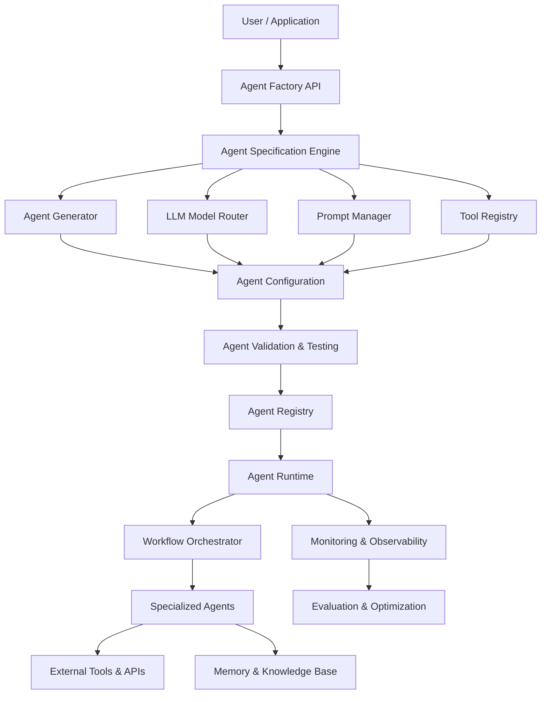
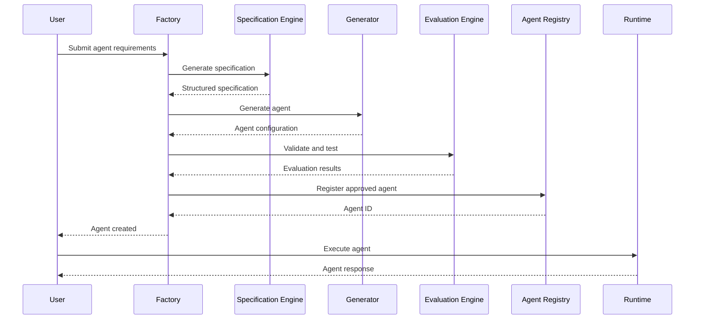

# LLM Agent Factory
## Architecture, Components, Technology Stack & Implementation Roadmap

**Version:** 1.0  
**Document Type:** Technical Architecture & Solution Overview  
**Status:** Proposed

---

## 1. Executive Summary

An **LLM Agent Factory** is a platform designed to automatically create, configure, test, deploy, orchestrate, and manage AI agents powered by Large Language Models (LLMs).

Rather than manually developing individual AI agents, the factory provides reusable components, templates, tools, workflows, and deployment infrastructure to generate specialized agents on demand.

The platform supports the entire agent lifecycle:

1. Agent specification and requirements gathering.
2. Automated agent generation.
3. LLM and model selection.
4. Prompt and instruction generation.
5. Tool and API integration.
6. Memory configuration.
7. Testing and evaluation.
8. Deployment and execution.
9. Monitoring and optimization.
10. Agent retirement and version management.

### Primary Objective

Build a scalable platform that transforms natural-language requirements into production-ready AI agents.

---

## 2. High-Level Architecture



### Architectural Layers

| Layer | Responsibility |
|---|---|
| User Interface | Agent creation and management |
| API Layer | External requests and integrations |
| Specification Engine | Converts requirements into agent definitions |
| Agent Generation | Creates agent configurations |
| Model Management | Selects and manages LLMs |
| Tool Management | Registers tools and integrations |
| Agent Runtime | Executes agents |
| Orchestration | Coordinates multiple agents |
| Memory | Maintains agent context and knowledge |
| Evaluation | Measures agent performance |
| Observability | Tracks execution, costs, and failures |

---

## 3. Core Components

### 3.1 Agent Specification Engine

Converts natural-language requirements into structured agent specifications.

Example input:

> Create an agent that analyzes financial reports, extracts key metrics, identifies risks, and generates executive summaries.

Expected output:

- Agent name: Financial Analyst
- Role: Financial report analysis
- LLM: Configurable
- Tools: PDF reader, financial data APIs
- Memory: Document and conversation context
- Output: Structured financial analysis
- Permissions: Read-only financial data access

### 3.2 Agent Generator

Responsible for generating agent configurations using reusable templates.

Capabilities:

- Agent template selection.
- Role and responsibility definition.
- System prompt generation.
- Tool assignment.
- Memory configuration.
- Workflow definition.
- Runtime configuration.

### 3.3 LLM Model Router

Provides model abstraction and selection.

Potential providers:

- OpenAI
- Anthropic
- Google Gemini
- Open-source models
- Self-hosted inference endpoints

Selection criteria:

- Quality
- Latency
- Cost
- Context window
- Tool-calling support
- Availability
- Data governance requirements

### 3.4 Prompt Manager

Manages agent instructions and prompt versions.

Features:

- Prompt templates.
- Dynamic prompt generation.
- Version control.
- Prompt testing.
- Prompt evaluation.
- Rollback support.

### 3.5 Tool Registry

Provides a centralized catalog of tools available to agents.

Examples:

- REST APIs
- Database connectors
- File readers
- Search services
- Python execution environments
- Enterprise applications
- MCP-based integrations

Tool access should follow least-privilege permissions.

### 3.6 Memory Manager

Supports different types of agent memory.

| Memory Type | Purpose |
|---|---|
| Working Memory | Current task context |
| Conversation Memory | Previous interactions |
| Episodic Memory | Historical task experiences |
| Semantic Memory | Knowledge and facts |
| Vector Memory | Semantic retrieval |
| Persistent Memory | Long-term agent state |

### 3.7 Workflow Orchestrator

Coordinates execution across individual agents.

Example:

A research workflow might include:

1. Research Agent
2. Data Collection Agent
3. Analysis Agent
4. Validation Agent
5. Report Generation Agent

The orchestrator manages task dependencies, execution state, retries, and handoffs.

### 3.8 Evaluation Engine

Evaluates agents before and after deployment.

Evaluation dimensions:

- Accuracy
- Reliability
- Task completion
- Hallucination rate
- Tool usage
- Latency
- Token consumption
- Cost per task
- Policy compliance

### 3.9 Agent Registry

Maintains the catalog of generated agents.

Each record should include:

- Agent ID
- Agent name
- Description
- Version
- Model configuration
- Prompt version
- Tool permissions
- Memory configuration
- Deployment status
- Created timestamp
- Owner

### 3.10 Monitoring and Observability

Provides visibility into agent execution.

Metrics:

- Number of executions
- Success and failure rates
- Execution duration
- LLM token consumption
- Cost per execution
- Tool invocation failures
- Agent quality scores
- Resource utilization

---

## 4. Agent Creation Workflow



### Detailed Workflow

**Step 1: Requirement Input**

The user describes the required agent in natural language.

**Step 2: Specification Generation**

The system creates a structured agent definition.

**Step 3: Model Selection**

The model router selects an appropriate LLM.

**Step 4: Agent Generation**

The factory generates prompts, tools, memory, and workflow configurations.

**Step 5: Validation**

The evaluation engine runs predefined tests.

**Step 6: Registration**

The validated agent is stored in the agent registry.

**Step 7: Deployment**

The agent becomes available through the runtime API.

**Step 8: Monitoring**

The platform collects operational and quality metrics.

---

## 5. Example Agent Types

| Agent | Responsibility |
|---|---|
| Research Agent | Researches topics and gathers information |
| Coding Agent | Assists with software development |
| Financial Agent | Analyzes financial information |
| Data Analyst Agent | Processes and analyzes datasets |
| Customer Support Agent | Handles customer requests |
| Document Agent | Extracts and summarizes documents |
| Compliance Agent | Reviews processes against policies |
| Project Manager Agent | Coordinates tasks and workflows |

---

## 6. Recommended Technology Stack

| Layer | Suggested Technologies |
|---|---|
| Backend | Python, FastAPI |
| Agent Framework | LangGraph, CrewAI |
| LLM Providers | OpenAI, Anthropic, Gemini |
| Workflow Engine | Temporal |
| API Gateway | Kong, NGINX |
| Database | PostgreSQL |
| Vector Database | pgvector, Qdrant |
| Cache | Redis |
| Message Broker | Kafka, RabbitMQ |
| Containerization | Docker |
| Orchestration | Kubernetes |
| Observability | OpenTelemetry, Prometheus, Grafana |
| Frontend | React, Next.js |
| Authentication | OAuth 2.0, OIDC |
| Deployment | Cloud or on-premises infrastructure |

These technologies are options rather than mandatory dependencies. The final selection should reflect operational requirements.

---

## 7. Suggested Data Model

### Agent

```json
{
  "agent_id": "agent-001",
  "name": "Financial Analyst",
  "description": "Analyzes financial reports",
  "version": "1.0.0",
  "model": {
    "provider": "openai",
    "model_name": "configurable"
  },
  "tools": [
    "document_reader",
    "financial_data_api"
  ],
  "memory": {
    "type": "persistent",
    "enabled": true
  },
  "status": "active"
}
```

### Agent Execution

```json
{
  "execution_id": "exec-001",
  "agent_id": "agent-001",
  "input": "Analyze the quarterly financial report",
  "status": "completed",
  "started_at": "2026-11-24T10:00:00Z",
  "completed_at": "2026-11-24T10:00:15Z"
}
```

---

## 8. Suggested API Design

| Method | Endpoint | Purpose |
|---|---|---|
| POST | /api/agents | Create an agent |
| GET | /api/agents | List agents |
| GET | /api/agents/{id} | Retrieve agent details |
| PUT | /api/agents/{id} | Update agent |
| DELETE | /api/agents/{id} | Retire an agent |
| POST | /api/agents/{id}/deploy | Deploy an agent |
| POST | /api/agents/{id}/execute | Execute an agent |
| GET | /api/agents/{id}/executions | Retrieve execution history |
| POST | /api/agents/{id}/evaluate | Evaluate an agent |
| GET | /api/metrics | Retrieve platform metrics |

---

## 9. Security and Governance

Security must be built into every stage of the agent lifecycle.

Key requirements:

- Authentication and authorization.
- Role-based access control.
- Least-privilege tool permissions.
- Secret and API key management.
- Tenant isolation.
- Input and output validation.
- Sandboxed execution.
- Human approval for sensitive actions.
- Audit logging.
- Rate limiting and budget controls.
- Prompt injection defenses.
- Data retention and privacy controls.
- Agent versioning and rollback.

Agents should not automatically receive unrestricted access to tools, credentials, databases, or other agents.

---

## 10. Implementation Roadmap

### Phase 1: Foundation

- Define platform architecture.
- Implement Agent Factory API.
- Build agent specification schema.
- Integrate one LLM provider.
- Create initial agent templates.
- Implement agent registry.

### Phase 2: Agent Generation

- Implement automated prompt generation.
- Implement tool registry.
- Add memory configuration.
- Create reusable agent templates.
- Implement agent validation.

### Phase 3: Runtime and Orchestration

- Build agent execution runtime.
- Integrate workflow orchestration.
- Implement multi-agent communication.
- Add task management.
- Implement execution persistence.

### Phase 4: Evaluation and Governance

- Add automated evaluation.
- Implement observability.
- Add RBAC and tenant isolation.
- Implement budget controls.
- Add audit and approval workflows.

### Phase 5: Enterprise Scale

- Add multi-model routing.
- Support horizontal scaling.
- Add advanced agent lifecycle management.
- Implement self-service agent creation.
- Add enterprise integrations.
- Support cloud and on-premises deployment.

---

## 11. Target End State

The completed LLM Agent Factory should provide:

1. Natural-language agent creation.
2. Automated agent configuration.
3. Multi-model support.
4. Reusable agent templates.
5. Centralized tool management.
6. Persistent agent memory.
7. Multi-agent orchestration.
8. Automated evaluation.
9. Production deployment.
10. Centralized monitoring and governance.
11. Agent versioning and lifecycle management.
12. Enterprise scalability.

---

## 12. Conclusion

The LLM Agent Factory provides a standardized platform for industrializing AI agent development.

Its central idea is to separate the creation of agents from their execution.

The factory handles agent generation, configuration, testing, and deployment, while the runtime handles task execution and collaboration.

This architecture makes it possible to move from manually building individual AI agents to operating a scalable ecosystem of specialized, governed, and reusable AI agents.

**Long-term vision:** A platform where users describe a business problem, and the factory generates, validates, deploys, and manages the AI agents needed to solve it.
