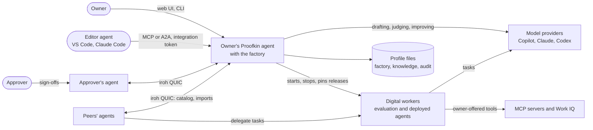
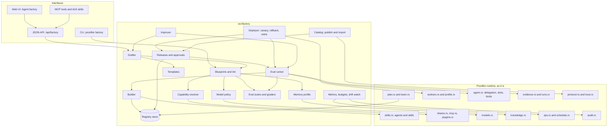
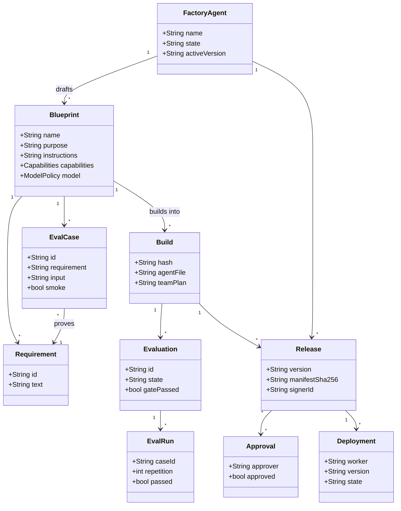

# Agent factory: architecture

How the agent factory fits inside Proofkin. The factory is a new module, `src/factory/`,
in the same binary: it composes what Proofkin already has (agent files, skills, digital
workers, model settings, shares and MCP offers, plans, signed evidence, audit and
operations) into one lifecycle, and adds what is missing: blueprints, builds, evaluations,
releases, deployments and a catalog. Every story it serves is in `spec/SPEC.md`.

## Context

The owner drives the factory from the web UI, the CLI or an editor agent. The factory
drafts and judges with the owner's own provider accounts, evaluates and runs agents as
digital workers, asks approvers for sign-offs over iroh, and publishes releases to the
peers the owner chooses.

## Components

| Component | Responsibility | Builds on |
| --- | --- | --- |
| Blueprints and lint (`blueprint.rs`) | The `proofkin.agent-blueprint/v1` format: parse, validate references (skills, topics, folders, providers, models), lint for least privilege; problems with fixes like the plan check's | `profile::validate_name`, `plan::Problem` style |
| Templates (`templates.rs`, `factory/templates/`) | Built-in blueprints with starter eval suites: code reviewer, implementer, researcher, document extractor, data analyst, compliance checker, support triage, project coordinator, financial analyst | Built-in skills |
| Drafter (`draft.rs`) | A description (and template) to a draft, written by the owner's default model, read-only and without tools, checked, at most 3 tries; records provenance | `team.rs` plan writing (tries, checked answer) |
| Builder (`build.rs`) | Blueprint to an agent file, namespaced skills and an optional team plan; byte-for-byte reproducible; a build hash over every artifact | `skills::AgentDef`, `team::validate_template` |
| Capability resolver (`capabilities.rs`) | Resolves access, MCP servers and tools, checks and Work IQ sources against the deployment folders' offers and grants; diffs capabilities between versions; never offers or grants | `shares`, `mcp`, `plugins`, `trust` |
| Model policy (`routing.rs`) | Candidates from providers, the profile's allowed models and efforts, MCP needs and cost caps; the recommendation from an evaluation | `models::ModelChoice`, `models::Offered` |
| Memory profile (`memory.rs`) | Knowledge topics the agent reads, the topic its lessons go to (verified results only), retention; Microsoft 365 labels follow | `knowledge`, `plan::save_knowledge` |
| Eval suites and graders (`evals.rs`, `adversarial.rs`) | Cases per requirement; deterministic expectations; judge rubrics; the built-in adversarial cases | `boundary`, `redact`, `evidence::CheckResult` |
| Eval runner (`runner.rs`) | Estimates, then runs each case as a real delegated task (repetitions, candidates) on an evaluation worker; grades; writes a signed report; survives restarts | `agent.rs` delegation, `runs`, plan journals |
| Releases and approvals (`release.rs`) | Semantic versions, the signed manifest of hashes, sign-offs (owner again for capability increases), offline verify | identity keys, `ApprovalRequest`, `runs verify` |
| Registry store (`store.rs`) | `<profile>/factory/`: drafts, builds, evaluations, releases, agent state and history; atomic, locked, hash-checked | `store.rs` atomic writes and locks |
| Deployer (`deploy.rs`) | A release as a digital worker pinned to it; canary with smoke cases; rollback; deprecate and retire | `workers::create`, `Supervisor` |
| Metrics, budgets, drift watch (`metrics.rs`) | Per-agent, per-version metrics from the audit; budgets enforced by the worker; scheduled evaluations as monitors with incidents | `audit`, `ops`, `schedule` |
| Improver (`improve.rs`) | A new draft version from failing cases and failed tasks, evaluated on the suite plus regression cases; never applied by itself | Drafter, runner |
| Catalog (`catalog.rs`) | Publishing releases to granted peers, the catalog in hello, importing bundles (verify, run nothing) | `protocol`, `trust`, plugins' import review |
| Interfaces | `proofkin factory ...`, the web UI's Agent factory, `/api/factory`, MCP tools (`factory_*`), A2A skills for deployed agents | `main.rs`, `ui.rs`, `ui/connect.rs` |

Changes to existing modules stay small: `skills.rs` gets a third agent source (`factory`,
after the profile's own and before plugins'); `plan.rs` resolves `agent=name@version` and
checks lifecycle states; `spec.rs` registers the `agent:*` built-in checks; `profile.rs`
pins a worker to a release; `agent.rs` applies the pinned release and its budgets to every
task; `audit.rs` records `agent@version` and usage; `protocol.rs` adds the catalog messages.

## Domain model

## Deployment

- No new process type, server or database: the factory runs inside the owner's `proofkin`
  agent (`--ui` for the web UI and the API, `--serve` for its workers).
- Evaluations run on an **evaluation worker**, a digital worker of the owner created on
  first use (`<owner>-eval`), so eval tasks never take production workers' slots. Fixtures
  live in `<profile>/factory/agents/<name>/fixtures/`, shared with that worker at the
  blueprint's access; edits happen in per-run worktrees.
- A deployment is a digital worker (`workers.rs`) whose profile pins `agent:
  name@version`; the owner's agent supervises it as it does every worker.
- Storage is the profile: `<profile>/factory/` holds drafts, builds (content-addressed),
  evaluations, releases and each agent's state and history; eval outputs are pruned after
  30 days.
- Peers need nothing new to delegate to a deployed agent: it is a worker on their
  allowlist. Importing published agents needs a version that understands the catalog
  messages; older peers ignore them (unknown message types are ignored).

## Quality attributes

| Attribute | Target | How |
| --- | --- | --- |
| Security | No agent gets more than its owner grants | Capabilities are requests; grants stay with shares, MCP offers and the allowlist; increases need the owner's sign-off; adversarial cases gate every release |
| Integrity | A release is exactly what was evaluated and approved | Content-addressed builds; the manifest signed with the owner's ed25519 key; verified on every load and import |
| Privacy | Descriptions, instructions and outputs stay on the owner's machine | Only the owner's provider sees them; the audit keeps no text; catalogs carry summaries; labels follow Microsoft 365 content |
| Reproducibility | The same blueprint always builds the same bytes | Deterministic builder; hashes in the manifest; provenance of every model-written part |
| Reliability | Deployments stay healthy | Canary with automatic rollback; evaluations journaled and resumed after restarts |
| Performance | API answers in under 2 seconds at the 95th percentile, model calls excluded | All state is local files; evaluations run in the background within task slots |
| Cost | No surprise spend | Estimates before evaluations; budgets per agent; usage where providers report it |
| Compatibility | Works with peers that don't know the factory | Deployed agents are ordinary workers; built agents are ordinary agent files |

## Decisions

- ADR-0001: Build the factory into Proofkin's local-first runtime instead of a hosted platform.
- ADR-0002: Blueprints are declarative data, built into ordinary agent files.
- ADR-0003: Evaluate on the real delegation path; checks prove, judges score.
- ADR-0004: Releases are immutable, content-addressed and signed; capability increases need the owner again.
- ADR-0005: A deployment is a digital worker pinned to a release, with a canary and rollback.
- ADR-0006: Memory is knowledge topics and verified lessons; no vector database in the first version.
- ADR-0007: Agents are shared peer to peer as signed releases; imports run nothing and are evaluated locally.
