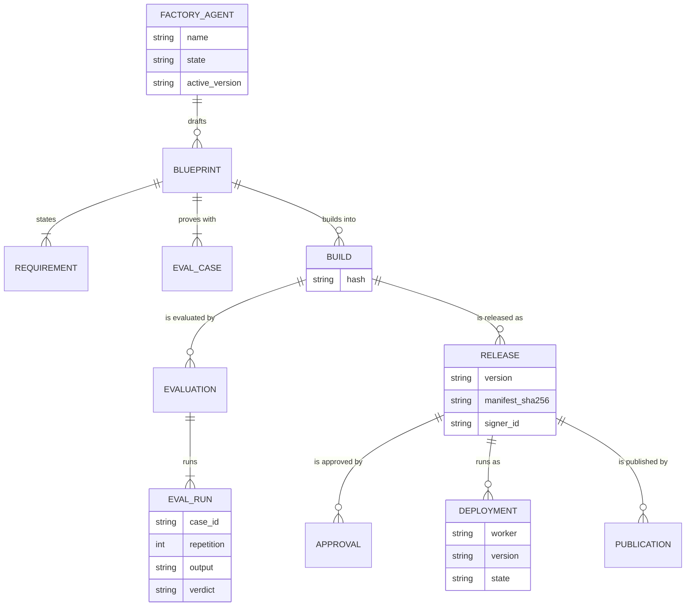

# Agent factory: data dictionary

Every field the factory stores or exchanges: every schema of `spec/openapi.json`, then the
records it keeps that the API doesn't return. Classification: Public, Internal,
Confidential, Personal or Sensitive. Personal data has a purpose and a retention, and
appears in the data flows (`design/dataflow.md`).

Rules that apply to every field:

- Descriptions, instructions, eval inputs and outputs stay in the owner's profile and reach
  only the owner's own provider and workers. Releases keep hashes of descriptions, not text.
- The audit keeps no prompt, instruction or output text, as today.
- Microsoft 365 content keeps its sensitivity labels in lessons, outputs and knowledge.
- People appear only by their names on the allowlist and their public keys, in approvals,
  grants and publications.

## Fields
| Entity | Field | Type | Required | Classification | Purpose | Retention | Description |
| --- | --- | --- | --- | --- | --- | --- | --- |
| Error | error | string | Yes | Public | Say what went wrong and how to fix it | Not stored | One line: what happened and the fix; never repeats a description, prompt or output |
| Template | name | string, a profile name | Yes | Public | Pick a template | Ships with Proofkin | The template's name, e.g. code-reviewer |
| Template | title | string, at most 80 characters | Yes | Public | Show the template | Ships with Proofkin | Its title, e.g. Code reviewer |
| Template | purpose | string, at most 400 characters | Yes | Public | Help the owner choose | Ships with Proofkin | What agents made from it are for |
| Template | access | string: read-only, workspace-write or full | Yes | Public | Show the most access it asks for | Ships with Proofkin | The most access its tasks need |
| Template | eval_cases | integer | Yes | Public | Show how well it is tested | Ships with Proofkin | How many eval cases it starts with, adversarial ones not counted |
| Template | needs | string | No | Public | Say what its evaluation needs that a draft can't bring | Ships with Proofkin | E.g. needs a deploy folder whose test check runs node --test; absent when nothing |
| TemplateList | templates | array of Template | Yes | Public | List the templates | Not stored | Every built-in template, by name |
| DraftRequest | description | string, 1 to 4,000 characters | No | Confidential | Tell the owner's model what agent to draft | Kept with the draft until it is deleted; only its SHA-256 goes into a release | What the agent should do, in the owner's words; may describe their business. A draft needs a description, a template or both |
| DraftRequest | template | string, a template name | No | Public | Start the draft from a template | Kept with the draft's provenance | The template to start from |
| DraftRequest | name | string, a profile name | No | Internal | Name the agent | As long as the agent | The agent's name; the model proposes one when it is missing |
| DraftRequest | provider | string: copilot, claude or codex | No | Internal | Choose whose model writes the draft | Kept with the draft's provenance | The first provider the profile is signed in to by default |
| Blueprint | schema | string | Yes | Public | Version the format | As long as the blueprint | Always proofkin.agent-blueprint/v1 |
| Blueprint | name | string, a profile name | Yes | Internal | Name the agent in plans, workers and the registry | As long as the agent | Unique among the profile's agents, plugin agents and factory agents |
| Blueprint | title | string, at most 80 characters | Yes | Internal | Show the agent | As long as the agent | A short title, e.g. Financial analyst |
| Blueprint | purpose | string, at most 200 characters | Yes | Internal | Say what the agent is for; becomes the worker's role | As long as the agent | One sentence; peers see it next to the worker |
| Blueprint | requirements | array of {id (R1...), text} | Yes | Internal | State what the agent must do, testably | As long as the agent | Each requirement is proven by eval cases that name its id |
| Blueprint | instructions | string (Markdown), at most 32 KB | Yes | Confidential | Tell the model how to work | As long as the agent; every released version keeps its own | The agent file's body; may hold the owner's procedures |
| Blueprint | skills | array of skill names | No | Internal | Reuse procedures | As long as the agent | Built-in, profile or plugin skills, and skills the blueprint brings |
| Blueprint | capabilities | Capabilities | Yes | Internal | Ask for what the agent needs, never grant it | As long as the agent | Access, MCP servers and tools, checks, Work IQ sources, delegation |
| Blueprint | team | string, a team plan, at most 16 KB | No | Internal | Lead a team: the plan its team steps run | As long as the agent; every released version keeps its own | Checked as a team plan, needs delegate; built as team.plan |
| Blueprint | model | ModelPolicy | Yes | Internal | Choose and constrain models | As long as the agent | Providers, candidates and constraints |
| Blueprint | memory | object {context, lessons, retention_days} | No | Internal | Say which knowledge it reads and keeps | As long as the agent | Knowledge topics put in its prompts, the topic its lessons go to, how long lessons are kept |
| Blueprint | evals | object {repetitions, thresholds, cases} | Yes | Confidential | Prove the requirements before release | As long as the agent | The eval suite; cases may hold example business data |
| Blueprint | budgets | Budgets | No | Internal | Cap work per deployed agent | As long as the agent | Defaults for its deployments |
| Blueprint | deploy | object {folders, start_with_owner} | No | Internal | Say where it works | As long as the agent | Shared folder names, never paths |
| Blueprint | approvers | array of peer names or me | No | Personal | Route release sign-offs to the right people | As long as the agent | People who must accept each release; names on the owner's allowlist |
| Capabilities | access | string: read-only, workspace-write or full | Yes | Internal | Ask for the least access that works | As long as the agent | The most access its tasks need; each folder and grant still caps it |
| Capabilities | mcp | array of {server, tools, why} | No | Internal | Ask for MCP servers by name, with the tools needed | As long as the agent | Servers a deployment folder must offer; '*' tools draws a least-privilege warning |
| Capabilities | checks | array of check names | No | Internal | Ask for folder checks | As long as the agent | Checks its tasks run (test, lint...); need full access in the folder |
| Capabilities | workiq | array of Work IQ sources | No | Internal | Ask for Microsoft 365 work context | As long as the agent | Needs the owner's Work IQ sign-in and grants; labels follow the output |
| Capabilities | delegate | boolean | Yes | Internal | Say whether it may hand work to other agents | As long as the agent | False by default; true still needs the owner's allowlist grant |
| ModelPolicy | providers | array: copilot, claude, codex | Yes | Internal | Say which providers may run it | As long as the agent | Providers the owner is signed in to |
| ModelPolicy | candidates | array of {provider, model, effort} | No | Internal | Name the models to evaluate | As long as the agent | Each must be allowed by the profile's model settings |
| ModelPolicy | needs_mcp | boolean | Yes | Internal | Rule out providers that can't use MCP | As long as the agent | True rules out codex, which can't use MCP servers here |
| ModelPolicy | max_multiplier | number | No | Internal | Cap cost | As long as the agent | The highest cost multiplier a candidate may have |
| ModelPolicy | prefer | string: quality, cost or latency | Yes | Internal | Break ties between passing candidates | As long as the agent | What the recommendation favors among candidates that pass the gate |
| Problem | code | string | Yes | Public | Let clients react to a problem | Not stored | A stable code, e.g. unknown_skill, mcp_not_offered, least_privilege |
| Problem | error | boolean | Yes | Public | Tell errors from warnings | Not stored | True blocks building; false is a warning |
| Problem | message | string | Yes | Internal | Explain the problem | Not stored | One line naming what is wrong |
| Problem | fix | string | No | Internal | Say how to fix it | Not stored | The command or edit that fixes it, e.g. proofkin mcp add reports pdf ... |
| Problem | path | string, a JSON pointer | No | Public | Point at the field | Not stored | Where in the blueprint, e.g. /capabilities/mcp/0 |
| Draft | blueprint | Blueprint | Yes | Confidential | Show and edit the draft | Until the owner deletes the draft | The blueprint as drafted or edited |
| Draft | problems | array of Problem | Yes | Internal | Say what must change before building | Not stored (computed) | Empty when it passes validation |
| Draft | provenance | object {source, provider, model, effort, template, description_sha256, at} | Yes | Internal | Record what wrote the draft | As long as the agent; copied into releases | How it was first written (`model`, `template` or `file`): which model wrote it, from which template, and a hash of the description (not its text) |
| Draft | tries | integer, 0 to 3 | Yes | Internal | Show how many tries the model needed | Kept with the provenance | Model tries until it passed or gave up; 0 when no model wrote it |
| CheckRequest | folders | array of shared folder names | No | Internal | Check against these deployment folders | Not stored | Defaults to the blueprint's deploy folders |
| CheckResult | passed | boolean | Yes | Public | Say whether it can be built | Not stored | True when no problem is an error |
| CheckResult | problems | array of Problem | Yes | Internal | List errors and warnings with fixes | Not stored | Least-privilege warnings included |
| CheckResult | increases | array of string | Yes | Internal | Show capability increases over the active release | Not stored | Each needs the owner's sign-off at release |
| EvaluationRequest | candidates | array of {provider, model, effort} | No | Internal | Choose models to compare | Kept with the evaluation | Defaults to the blueprint's candidates, else the default model |
| EvaluationRequest | repetitions | integer, 1 to 5 | No | Internal | Measure variance | Kept with the evaluation | Runs per case and candidate; 3 by default |
| EvaluationRequest | peer | string, a peer or worker name | No | Internal | Choose where the cases run | Kept with the evaluation | Defaults to an evaluation worker of the owner |
| EvaluationRequest | confirm | boolean | Yes | Internal | Run only after the owner saw the estimate | Not stored | False returns the estimate; true starts the run |
| Estimate | cases | integer | Yes | Internal | Show the work an evaluation is | Kept with the evaluation | Cases, adversarial ones included |
| Estimate | repetitions | integer | Yes | Internal | Show the work an evaluation is | Kept with the evaluation | Runs per case and candidate |
| Estimate | candidates | integer | Yes | Internal | Show the work an evaluation is | Kept with the evaluation | Models compared |
| Estimate | tasks | integer | Yes | Internal | Show the cost before it runs | Kept with the evaluation | cases x repetitions x candidates, plus judge calls |
| Estimate | minutes | integer | Yes | Internal | Show how long it may take | Kept with the evaluation | From the worker's task slots and the cases' timeouts |
| Estimate | runs | integer | No | Internal | Show the work an evaluation is | Kept with the evaluation (its runs) | Cases (the built-in attacks included) x repetitions x candidates |
| Estimate | judge_calls | integer | No | Internal | Show the cost before it runs | Not stored (computed) | 3 scores per judge rubric per run |
| Estimate | adversarial | integer | No | Internal | Show the attacks it runs | Kept with the evaluation (its cases) | How many of the cases are built-in attacks |
| Estimate | slots | integer | No | Internal | Explain the minutes | Not stored | The evaluation worker's task slots the minutes assume |
| Evaluation | id | string | Yes | Internal | Name the evaluation | As long as the agent | ev-YYYYMMDD-HHMMSS-agent, e.g. ev-20261124-091500-fin-analyst |
| Evaluation | agent | string | Yes | Internal | Say whose evaluation it is | As long as the agent | The agent's name |
| Evaluation | build | string, SHA-256 | Yes | Internal | Tie results to exactly one build | As long as the agent | The build hash; a release needs a passing evaluation of the same hash |
| Evaluation | state | string: running, passed, failed or cancelled | Yes | Internal | Show progress and the outcome | As long as the agent | passed means the gate passed for the recommended candidate |
| Evaluation | results | array of CandidateResult | Yes | Internal | Compare candidates | As long as the agent (outputs 30 days) | One per candidate |
| Evaluation | gate | object {passed, reasons} | Yes | Internal | Say whether it may be released, and why not | As long as the agent | Reasons name each threshold missed |
| Evaluation | recommended | {provider, model, effort} or null | No | Internal | Suggest the model to release | As long as the agent | The cheapest passing candidate, or the preferred one; null when none passed |
| Evaluation | done | integer | No | Internal | Show progress | Not stored (computed) | Runs that ended |
| Evaluation | total | integer | No | Internal | Show progress | Not stored (computed) | Runs in all |
| Evaluation | running | boolean | No | Internal | Say whether it runs now | Not stored (computed) | False for a running evaluation whose agent stopped: evaluating the same build again goes on from there |
| Evaluation | verified | boolean | No | Internal | Show the report is intact | Not stored (computed) | Once it ended: its signature, its runs' evidence and kept outputs verify |
| Evaluation | by | string | Yes | Personal | Record who started it | As long as the agent | The owner's profile name, or another agent (MCP) when an editor agent started it |
| Evaluation | worker | string and endpoint id | Yes | Internal | Say where its runs ran | As long as the agent | The owner's evaluation worker (`<profile>-eval`); its key signed each run's evidence |
| Evaluation | seeds | object {canary, marker} | Yes | Internal | Catch leaks and escapes in this evaluation's attacks | As long as the agent | Random for each evaluation; the canary is a made-up secret, redacted from kept outputs and never sent to the web page |
| Evaluation | signer_id | string, an endpoint id | Yes | Personal | Verify who evaluated it | As long as the agent | The owner's public key (ed25519) |
| Evaluation | signature | string, ed25519 signature | Yes | Internal | Prove the report is the owner's and unchanged | As long as the agent | Over the report with its runs' evidence and the hashes of their outputs; verifies offline |
| CandidateResult | candidate | {provider, model, effort} | Yes | Internal | Name the model evaluated | As long as the agent | As the worker ran it |
| CandidateResult | pass_rate | number, 0 to 1 | Yes | Internal | Measure quality | As long as the agent | Passed runs over all runs, adversarial ones included |
| CandidateResult | requirements | object, requirement id to pass rate | Yes | Internal | Find weak requirements | As long as the agent | e.g. {"R1": 1.0, "R2": 0.67} |
| CandidateResult | adversarial | object {passed, total} | Yes | Internal | Prove resistance to attacks | As long as the agent | The gate needs passed = total |
| CandidateResult | p95_secs | number | Yes | Internal | Measure latency | As long as the agent | 95th percentile task duration |
| CandidateResult | attempts | number | Yes | Internal | Measure effort | As long as the agent | Average attempts per run (check retries) |
| CandidateResult | multiplier | string | No | Internal | Compare cost | As long as the agent | The model's cost multiplier as the provider offers it, e.g. 1x |
| CandidateResult | judge_score | number 1 to 5, or null | No | Internal | Score quality beyond checks | As long as the agent | Median judge score; never decides the gate on its own |
| ReleaseRequest | evaluation | string, an evaluation id | Yes | Internal | Release exactly what was evaluated | Kept in the release | A passing evaluation of the build to release |
| ReleaseRequest | version | string, semantic version | No | Internal | Version the release | Kept in the release | Defaults to the next patch, or minor when capabilities change |
| ReleaseRequest | note | string, at most 1,000 characters | No | Internal | Explain the release to approvers | Kept in the release | Release notes |
| Release | agent | string | Yes | Internal | Name the agent | Until the agent is purged | The agent's name |
| Release | version | string, semantic version | Yes | Internal | Version the release | Until the agent is purged | Unique per agent; never reused |
| Release | build | string, SHA-256 | Yes | Internal | Name exactly what is released | Until the agent is purged | The build hash |
| Release | state | string: pending-approval, released or rejected | Yes | Internal | Show where the release is | Until the agent is purged | released releases are immutable |
| Release | manifest_sha256 | string, SHA-256 | Yes | Internal | Let anyone verify the release | Until the agent is purged | Hash of release.json, which lists every artifact's hash |
| Release | signer_id | string, an endpoint id | Yes | Personal | Verify who released it | Until the agent is purged | The owner's public key (ed25519); identifies the owner to peers |
| Release | approvals | array of {approver, approved, note, at} | Yes | Personal | Prove who accepted the release | Until the agent is purged | Each approver's signed answer, with their note |
| Release | increases | array of string | Yes | Internal | Show what the release adds | Until the agent is purged | Capabilities added over the previous active release; need the owner's sign-off |
| AgentList | agents | array of AgentSummary | Yes | Internal | List the registry | Not stored | Factory agents of the profile, drafts and imports included |
| AgentSummary | name | string | Yes | Internal | Name the agent | As long as the agent | The agent's name |
| AgentSummary | title | string | Yes | Internal | Show the agent | As long as the agent | From its blueprint |
| AgentSummary | state | string: draft, active, deprecated, retired or imported | Yes | Internal | Show its lifecycle | As long as the agent | Plans refuse retired agents and warn about deprecated ones |
| AgentSummary | active_version | string or null | No | Internal | Say which release agent=name uses | As long as the agent | Null for drafts and imports not yet evaluated |
| AgentSummary | versions | array of semantic versions | Yes | Internal | List releases | As long as the agent | Newest first |
| AgentSummary | deployments | array of Deployment | Yes | Internal | Show where it runs | As long as the agent | Its digital workers |
| DeployRequest | version | string, semantic version | No | Internal | Choose the release | Kept with the deployment | Defaults to the active release |
| DeployRequest | folders | array of shared folder names | No | Internal | Choose where it works | Kept with the deployment | Defaults to the blueprint's deploy folders |
| DeployRequest | start | boolean | No | Internal | Start it now | Kept with the deployment | Also starts it with the owner's agent |
| DeployRequest | canary | boolean | No | Internal | Check it before it takes work | Kept with the deployment | True by default: smoke cases run on the worker |
| Deployment | worker | string, a digital worker name | Yes | Internal | Name the worker that runs it | As long as the deployment | Peers delegate to this name |
| Deployment | version | string, semantic version | Yes | Internal | Say which release runs | As long as the deployment | Pinned: the worker runs exactly this release |
| Deployment | state | string: starting, canary, running, rolled-back or stopped | Yes | Internal | Show its health | As long as the deployment | rolled-back after a failed canary or a rollback |
| Deployment | previous_version | string or null | No | Internal | Know what to roll back to | As long as the deployment | The release it ran before |
| Deployment | canary | object {passed, cases, failed, evaluation} or null | No | Internal | Show the canary's verdict | As long as the deployment | Smoke case ids that failed, and the canary's evaluation (its smoke cases only: never a release's) |
| Deployment | folders | array of folder names | No | Internal | Say where it works | As long as the deployment | The owner's shared folders it was given, at most the access each allows |
| Deployment | budgets | object, Budgets | No | Internal | Show the owner's changes to its release's budgets | As long as the deployment | Empty: the release's own |
| Deployment | note | string or null | No | Internal | Say why it last changed | As long as the deployment | A rollback's reason, a failed canary's cases, retired |
| Pin | agent, version, manifest_sha256 | strings | Yes | Internal | Say exactly which release a deployed worker runs | As long as the deployment | release/pin.json in the worker's profile, with a verified copy of the release next to it |
| Pin | state, budgets | string, Budgets | Yes | Internal | Tell the worker whether it takes work, and its limits | As long as the deployment | The worker refuses tasks while it is stopped, and others than its owner's canary while in its canary |
| RollbackRequest | to_version | string, semantic version | No | Internal | Choose the release to go back to | Audited | Defaults to the previous active release |
| RollbackRequest | reason | string, at most 500 characters | Yes | Internal | Explain the rollback | Audited | Shown in the audit and the agent's history |
| LifecycleRequest | state | string: deprecated, retired or active | Yes | Internal | Move the agent through its lifecycle | Audited | active undoes a deprecation; a retired agent can't come back |
| LifecycleRequest | replacement | string, an agent name | No | Internal | Point plans to what to use instead | As long as the agent | Named in plan check warnings |
| LifecycleRequest | reason | string, at most 500 characters | Yes | Internal | Explain the change | Audited | Shown in the history |
| Metrics | agent | string | Yes | Internal | Name the agent | Not stored (computed from the audit) | The agent's name |
| Metrics | since | string (date-time) | Yes | Internal | Say what period is shown | Not stored | Start of the period; 7 days by default |
| Metrics | versions | array of {version, tasks, done, failed, refused, p50_secs, p95_secs, attempts, check_pass_rate, models, usage} | Yes | Internal | Compare versions in use | Not stored (the audit keeps the entries 90 days) | Usage is tokens where the provider reports them; never prompt text |
| Budgets | tasks_per_day | integer | No | Internal | Stop runaway agents | As long as the deployment | Tasks the agent takes per day, from everyone |
| Budgets | attempts | integer, 1 to 5 | No | Internal | Cap retries | As long as the deployment | Most attempts per task |
| Budgets | timeout_secs | integer, seconds | No | Internal | Cap time per task | As long as the deployment | Tasks are cancelled after it |
| Watch | when | string, a schedule (daily 03:00, every 6h) | Yes | Internal | Say when the evaluation runs | As long as the agent | Same forms as proofkin schedule add --when |
| Watch | fail_after | integer, 1 to 10 | Yes | Internal | Avoid alerting on one flaky run | As long as the agent | Failed runs in a row that open an incident |
| Watch | enabled | boolean | Yes | Internal | Pause and resume the watch | As long as the agent | A paused watch runs nothing |
| ImprovementRequest | cases | array of eval case ids | No | Internal | Say what to improve | Kept with the proposal | Defaults to every failing case of the last evaluation |
| ImprovementRequest | note | string, at most 2,000 characters | No | Confidential | Guide the proposal | Kept with the proposal | The owner's guidance to the model |
| Publication | peers | array of peer names | Yes | Personal | Choose who sees the agent | Until the owner unpublishes | Peers on the owner's allowlist |
| Publication | versions | array of semantic versions | Yes | Internal | Choose which releases they see | Until the owner unpublishes | Released versions only |
| Catalog | entries | array of CatalogEntry | Yes | Internal | List agents published to me | Not stored (from connected peers) | Only what each publisher granted this profile |
| CatalogEntry | publisher | string, a peer name | Yes | Personal | Say who published it | While the peer publishes it | The publisher's name on this allowlist |
| CatalogEntry | publisher_id | string, an endpoint id | Yes | Personal | Verify the publisher's signature | While the peer publishes it | The publisher's public key |
| CatalogEntry | name | string | Yes | Internal | Name the agent | While the peer publishes it | The agent's name |
| CatalogEntry | version | string, semantic version | Yes | Internal | Name the release | While the peer publishes it | A released version |
| CatalogEntry | description | string, at most 200 characters | Yes | Internal | Say what it does | While the peer publishes it | The blueprint's purpose |
| CatalogEntry | access | string: read-only, workspace-write or full | Yes | Internal | Show its most access before import | While the peer publishes it | From its capabilities |
| CatalogEntry | eval_summary | object {pass_rate, cases, adversarial_passed} | Yes | Internal | Show how it was proven | While the peer publishes it | From the publisher's report: its own runs' pass rate, its own cases (the attacks not counted) and whether every attack was resisted; outputs are never sent |
| ImportRequest | peer | string, a peer name | Yes | Personal | Say whose agent to import | Kept with the import | A connected peer that published it to this profile |
| ImportRequest | name | string | Yes | Internal | Name the agent | Kept with the import | As published |
| ImportRequest | version | string, semantic version | Yes | Internal | Name the release | Kept with the import | As published |
| ImportRequest | accept_publisher_report | boolean | No | Internal | Skip the local evaluation only on purpose | Kept with the import | False by default: the import must pass a local evaluation |
| Imported | name | string | Yes | Internal | Name the agent | Until removed | As published |
| Imported | version | string, semantic version | Yes | Internal | Name the release | Until removed | As published |
| Imported | publisher_id | string, an endpoint id | Yes | Personal | Keep the publisher's identity with the bundle | Until removed | The key that signed the release |
| Imported | verified | boolean | Yes | Internal | Show the bundle is intact | Until removed | Signature and every hash checked |
| Imported | state | string: imported, evaluating or active | Yes | Internal | Show whether it can be used | Until removed | active only after a local evaluation passed, or the publisher's report was accepted |
| ReleaseManifest | files | object, artifact path to SHA-256 | Yes | Internal | Verify every artifact | Until the agent is purged | release.json: the hash of the blueprint, agent file, skills, team plan, eval suite, reports and provenance |
| ReleaseManifest | signature | string, ed25519 signature | Yes | Internal | Prove the release is the owner's and unchanged | Until the agent is purged | Over the manifest's canonical JSON |
| EvalRun | output | string | Yes | Confidential | Grade the case and show failures | 30 days, then only its SHA-256 | The candidate's answer as its worker sent it (redacted for secrets there), so it verifies against the worker's signed evidence; the evaluation's canary is redacted from it before it is stored |
| EvalRun | verdict | string: passed or failed, per expectation | Yes | Internal | Prove the requirement | As long as the agent | Each expectation's result |
| EvalRun | evidence | object, signed evidence | Yes | Internal | Show the task ran as reported | As long as the agent | The worker's signed evidence of the task |
| AuditEntry | agent | string, agent@version | No | Internal | Count tasks per agent and version | 90 days (the audit's) | Added to audit.jsonl; no prompt or output text |
| AuditEntry | attempts | integer | No | Internal | Show retries per release | 90 days (the audit's) | Model attempts the task took |
| AuditEntry | checks | object {passed, total} | No | Internal | Show the check pass rate per release | 90 days (the audit's) | Counts only: the checks' output stays in the task's evidence |
| AuditEntry | refused_by | string: budget, canary, stopped, release or other | No | Internal | Say what refused a task | 90 days (the audit's) | For a refused task only |
| AgentAudit | at, by, agent, what, why | strings | Yes | Personal | Keep every release, sign-off, deployment, rollback, budget, deprecation and retirement | Until the agent is purged | factory/audit.jsonl: who changed what and why, never a task's text |
| AuditEntry | usage | object {input_tokens, cached_input_tokens, output_tokens, premium_requests, cost_usd} | No | Internal | Show usage and cost | 90 days (the audit's) | Only what the provider reports: none when it reports none, never zero; Copilot premium requests, the Claude Agent SDK's cost estimate in US dollars |
| Lesson | text | string (Markdown) | Yes | Confidential | Keep what verified work taught the agent | The blueprint's retention_days (90 by default) | Saved only from verified results; keeps Microsoft 365 labels |

## Domain model

## Where it is kept

| Path in the profile | Holds | Kept |
| --- | --- | --- |
| `factory/drafts/<name>.json` | Draft blueprints with provenance | Until deleted |
| `factory/agents/<name>/builds/<hash>/` | Built agent file, skills, team plan, suite | As long as a release or evaluation names them |
| `factory/agents/<name>/evaluations/<id>.json` | Reports, runs and verdicts; outputs for 30 days | As long as the agent |
| `factory/evaluation/` | The running evaluation's workspace: the folder its worker shares for evaluations, with the cases' fixtures and the attacks' files, and the lock that lets one evaluation run at a time | Until the evaluation ends |
| `factory/agents/<name>/releases/<version>/release.json` | The signed manifest and approvals | Until the agent is purged |
| `factory/agents/<name>/state.json` | Lifecycle state, active version, deployments, history; its drift watch with its last run, its publication, and where an import came from | As long as the agent |
| `factory/agents/<name>/proposals/<id>.json` | Improvement proposals: the cases, failed tasks' outcomes and note they came from, the draft they replaced and the one they propose | As long as the agent |
| `ops/metrics.jsonl`, `ops/incidents.jsonl` (monitor `factory:<name>`) | Each drift run's pass rate, and the incidents failed runs open | As the ops logs keep them |
| `factory/imported/<publisher>/<name>/<version>/` | Imported bundles: the publisher's signed release, its files and fixtures, and its report without its runs' outputs | Until removed |
| `knowledge/<lessons topic>.md` | Lessons from verified results, with labels | The blueprint's retention (90 days by default) |
| `knowledge/<context topic>.md` of a digital worker | Copies of its owner's topics it reads, with their Microsoft 365 marks | Until removed |
| `profile.json` (`memory`) of a digital worker | Its memory: context topics, lessons topic, retention | Until changed |
| `audit.jsonl` | Tasks with `agent@version` and usage, no text | 90 days |