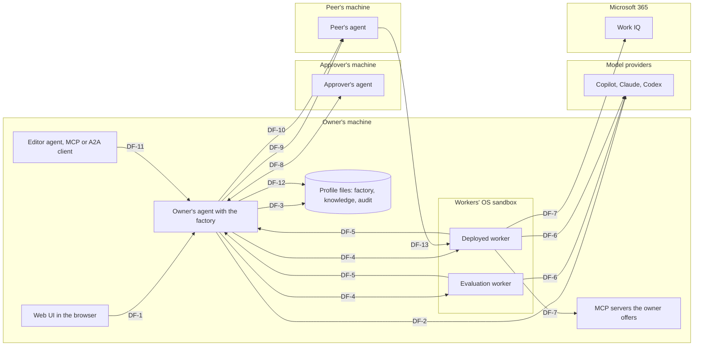

# Agent factory: data flows

Where the factory's data goes, and how it is protected where it crosses a trust boundary
(each boundary is a subgraph). Field details are in `design/data-dictionary.md`.

| ID | From | To | Data | Boundary | Protection |
| --- | --- | --- | --- | --- | --- |
| DF-1 | Web UI | Owner's agent | DraftRequest description, Blueprint edits, evaluation and release requests, deployments | Yes | Loopback only (127.0.0.1); the web UI's token on every call; Origin and Host checks against other sites and DNS rebinding |
| DF-2 | Owner's agent | Model provider | Drafting: description, template, catalog names and descriptions; judging: rubric and output; improving: failing cases | Yes | The profile's own provider instance and credentials over TLS; secrets redacted; outputs inside the external-content envelope; the model works read-only with no tools |
| DF-3 | Owner's agent | Profile files | Blueprint (with approvers), Build, Evaluation, Release (signer and approvals), Deployment, agent state | No | Atomic writes and file locks; owner-only files; hashes and signatures checked when loaded |
| DF-4 | Owner's agent | Evaluation or deployed worker | Tasks: the release's instructions and skills, the case or task text, folder names | Yes | iroh QUIC with ed25519 keys; the worker's allowlist; the lower of grant and folder access; OS sandbox; external-content envelope |
| DF-5 | Worker | Owner's agent | EvalRun output, files changed, signed evidence, usage | Yes | Evidence signed by the worker's key; secrets redacted before sending; size caps |
| DF-6 | Worker | Model provider | The task's prompt with the release's instructions | Yes | The owner's accounts in the worker's private provider homes; per-access tool allowlists; path checks; no web, memory or sub-agents |
| DF-7 | Deployed worker | MCP servers and Work IQ | Tool calls and results | Yes | Only servers the folder's owner offers, only their allowed tools; Work IQ through the per-task gateway within labels and budgets; results inside the envelope |
| DF-8 | Owner's agent | Approver's agent | Release sign-off request (diff, eval summary, provenance) and the signed answer | Yes | iroh and the allowlist; answers signed and matched to the request; at most 20 open requests per peer |
| DF-9 | Owner's agent | Peer's agent | CatalogEntry for each Publication granted to the peer (name, version, description, access, eval summary) | Yes | Sent only to granted peers; never knowledge, eval outputs or paths; signed by the publisher's key |
| DF-10 | Owner's agent | Peer's agent | Release bundle for an ImportRequest, stored as Imported (blueprint, agent file, skills, evals, report, manifest) | Yes | Only for a release published to that peer; signature and every hash verified; importing runs nothing; local evaluation before activation |
| DF-11 | Editor agent | Owner's agent | Factory tool calls: draft, check, evaluate, status | Yes | The integration token (not the web UI's); loopback only; Origin and Host checks; release, deploy, rollback, retire and approvals refused |
| DF-12 | Owner's agent | Audit file | AuditEntry with agent@version, outcome, duration, model, usage | No | No prompt, instruction or output text; 90 days |
| DF-13 | Peer's agent | Deployed worker | Tasks for the deployed agent | Yes | The worker's allowlist and delegate grant, hourly limit, the release's budgets, access levels and sandbox |
