# Agent factory: workflows

Each workflow names the user stories it implements (`spec/SPEC.md`).

## Describe and draft an agent (US-1, US-2)

The owner describes the agent, optionally from a template. The owner's default model
writes the draft read-only, without tools; the factory checks it and sends problems back,
at most 3 tries. Nothing is granted.

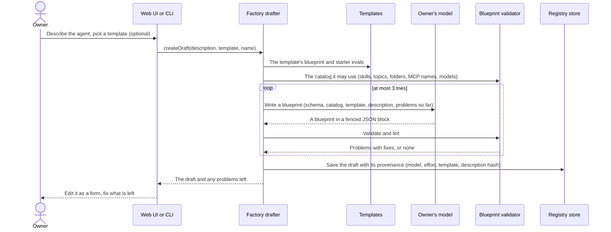

## Check capabilities against what the owner offers (US-3)

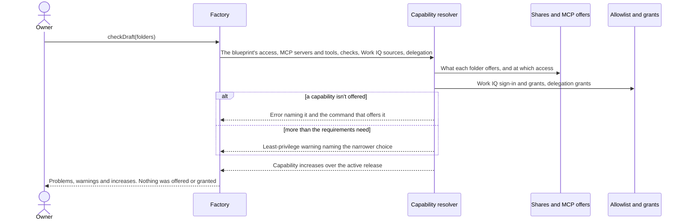

## Evaluate a build across models (US-4)

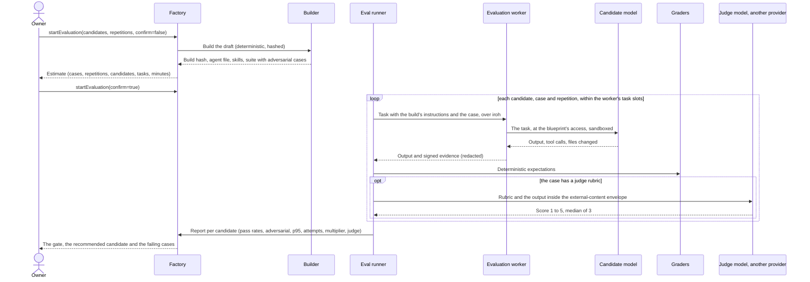

## Release with sign-offs (US-5)

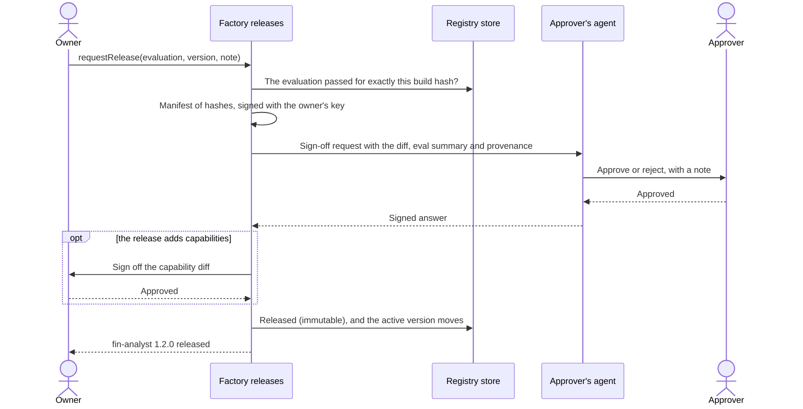

## Deploy with a canary, roll back (US-6)

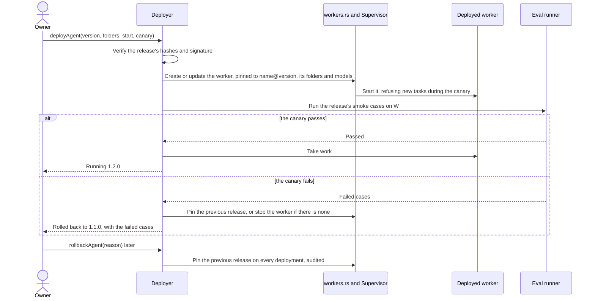

## Use a factory agent in a plan (US-7)

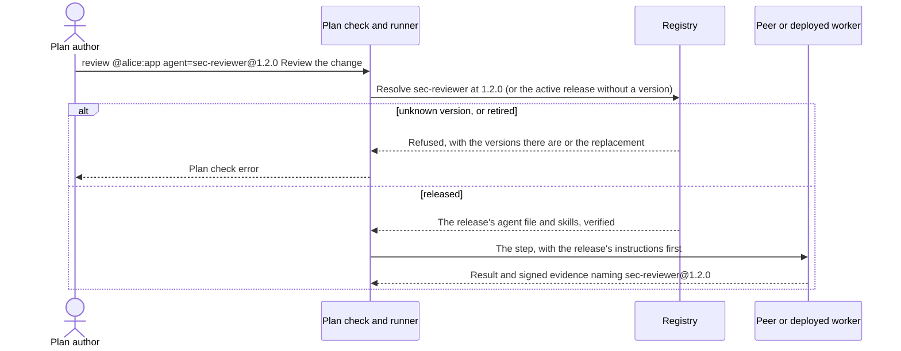

## Metrics, budgets and drift (US-8, US-9)

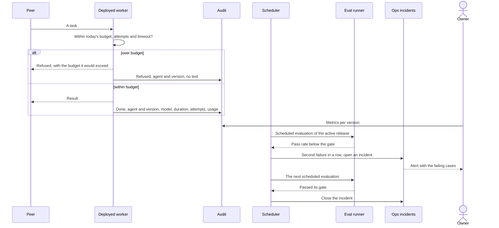

## Improve an agent (US-9)

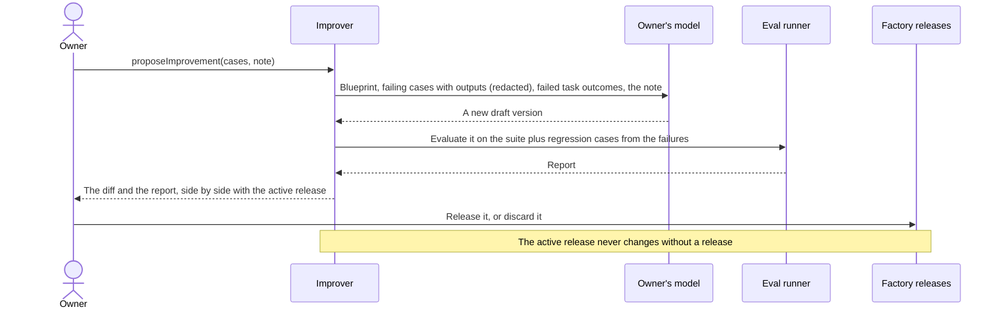

## Publish and import (US-10)

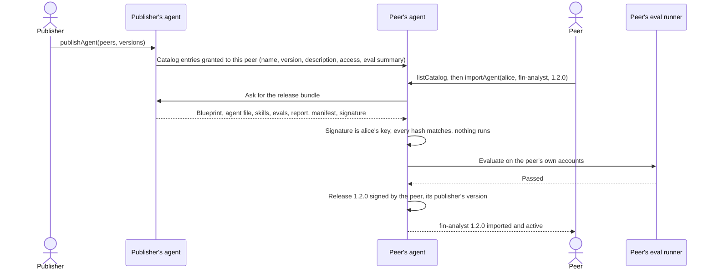

## Deprecate and retire (US-11)

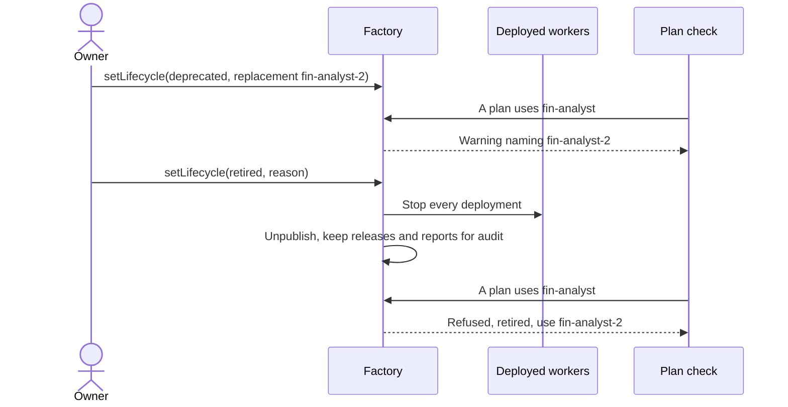

## Editor agents (US-12)

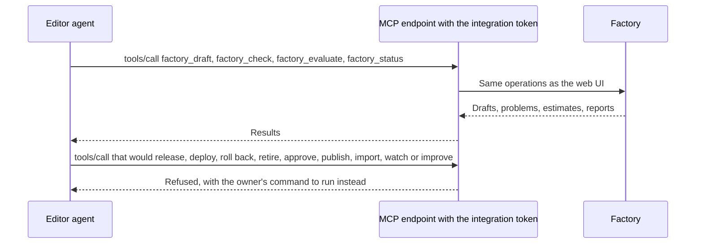

## Memory: context and lessons (US-13)

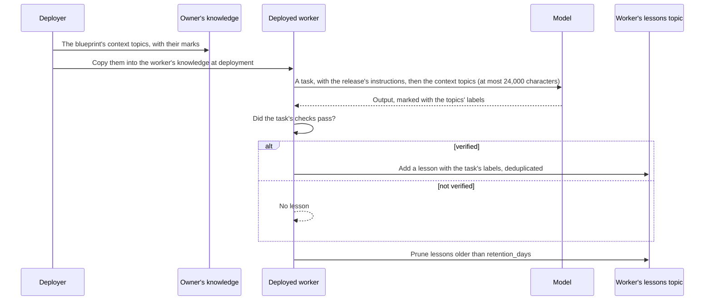

## The agent lifecycle

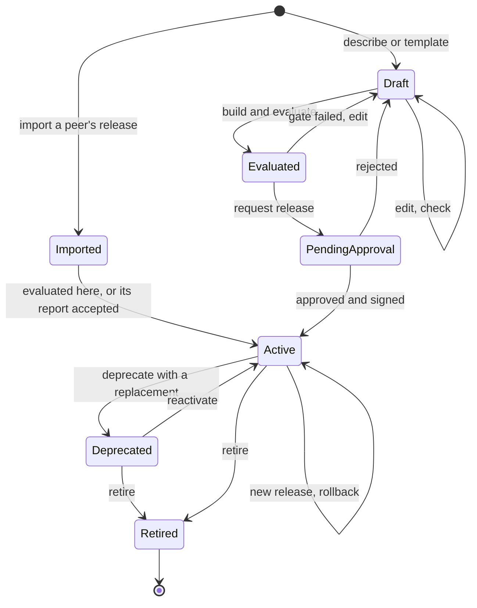

## Agents as code: the pipeline as a plan (US-14)

The `agent-factory` playbook runs the same lifecycle with peers, in a folder under git:
blueprint and evals as files, built-in `agent:*` checks, a red-team squad and sign-offs.

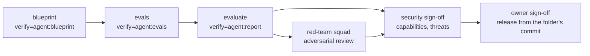
