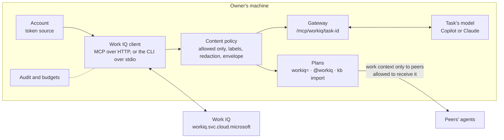

# Work IQ in Proofkin: Microsoft 365 work context (design)

Status: designed, being built with Proofkin. Tracked in
[#36](https://github.com/mcbelton/proofkin/issues/36), one sub-issue per piece of work (see
[Work items](#work-items)). Until an item is closed, what it describes doesn't exist yet.

## Why

The decisions and requirements behind code live in Microsoft 365: specs in Word and
SharePoint, decisions in meetings, threads in Teams and mail. [Work
IQ](https://learn.microsoft.com/en-us/microsoft-365/copilot/extensibility/work-iq/mcp/overview)
is Microsoft's service that lets an agent search and ask about that data as the signed-in
person, under the tenant's permissions, sensitivity labels and policies. With it, a plan can
start from what the team actually decided, and a task can look things up while it works.

Two things make this more than another MCP server:

- **Proofkin is peer to peer.** Peers can belong to other people and other companies, so
  work data has to stay with the person it belongs to unless they decide otherwise.
- **Work IQ is per person and costs money.** It runs on the owner's delegated sign-in (there
  is no app-only access) and bills Copilot Credits per call.

## What Work IQ offers

| | |
| --- | --- |
| MCP endpoint | `https://workiq.svc.cloud.microsoft/mcp` (streamable HTTP). Its metadata (`/.well-known/oauth-protected-resource/mcp`) names the authority `https://login.microsoftonline.com/organizations/v2.0` and the scope `WorkIQAgent.Ask`. |
| A2A endpoint | `https://workiq.svc.cloud.microsoft/a2a` (A2A 1.0 with `A2A-Version: 1.0`); agent cards at `/a2a/.well-known/agent-card.json`. |
| Tools | `retrieve` (cited search over mail, meetings, files, Teams, people and connectors), `ask` (an answer from Microsoft 365 Copilot or a declarative agent), `fetch`, `fetch_blob`, `search_paths`, `get_schema`, `list_agents`, `discover`, `call_function` (read only by its annotations). Changes: `create_entity`, `update_entity`, `delete_entity`, `do_action`. `tools/list` is the source of truth. |
| Permissions | Delegated only, each needing admin consent: `WorkIQAgent.Ask` (ask agents; reads *and* writes), `WorkIQ.Read`, `WorkIQ.Act`. Resource `api://workiq.svc.cloud.microsoft` (app id `fdcc1f02-fc51-4226-8753-f668596af7f7`). |
| Tenant setup | The resource's service principal, a client app registration with admin consent, usage-based billing with a spending policy covering the users, and the Work IQ MCP policy (changes are blocked by default; policy changes take up to 24 hours). |
| CLI | [`@microsoft/workiq`](https://github.com/microsoft/work-iq) (npm): `workiq mcp` is a local stdio MCP server that signs in by itself with Microsoft's Work IQ CLI app. |

Retrieval results are in `structuredContent["application/vnd.ms-workiq.retrieval"].results`
(the MCP `content` array can be empty): each has `markdown` with `[^h1]` citations, `webUrl`,
`entityType`, `resourceMetadata`, `sensitivityLabel` and `contentProtection`. Only
`contentProtection: "allowed"` is an allow decision; a missing, failed, blocked or unknown
value is not. A call failed if it has `isError: true` or `stoppedReason: "error"`, possibly
with `errorCode`, `recoveryAction` and `retryAfterSeconds`. Policy denials must not be retried.

What the Work IQ CLI 1.0.1 returned in a Microsoft tenant (seven queries, 36 results;
[#94](https://github.com/mcbelton/proofkin/issues/94)):

| Result | `entityType` | `resourceMetadata` | `sensitivityLabel` | `contentProtection` |
| --- | --- | --- | --- | --- |
| Files | `Files` | `document.title` | an object: `displayName`, `id`, `color`, `priority`, `isEncrypted`, `tooltip` | `allowed` |
| Mail | `Emails` | `email.subject`, `email.sentTime` | the same object | `allowed` |
| Meetings | `Meetings` | `meeting.title`, `meeting.startTime` | none (no key) | `allowed` |
| Teams messages | `Chats` | `chat.title` | none | `allowed` |
| People | `People` | `web.title` | none | none |

- No result had a `relevanceScore`: results keep Work IQ's order. Every one had `webUrl`,
  `entityUrl` and `resourceId`.
- `structuredContent` also has `@workiq.untrustedContent`, a notice (a string) that the
  content is untrusted. Proofkin treats all of it that way anyway.
- No result had an empty or null `sensitivityLabel`: meetings, chats and people have none at
  all, so their sensitivity isn't known and they go to no peer (the `unlabeled` grant matched
  nothing in this sample). People results have no `contentProtection`, so they are withheld.
- `ask` gives its answer twice: as the text `content` and as `structuredContent.answer`, with
  the `conversationId`. It has no citations, so an answer has no labels and stays local.
  Work IQ's [tool reference](https://learn.microsoft.com/microsoft-365/copilot/extensibility/work-iq/mcp/tool-reference)
  documents the text as a JSON object with the answer in `response`: without a structured
  answer, Proofkin reads that, else the text as it is.
- `list_agents` gives no `structuredContent`: the agents are a JSON array in the text
  `content`, each `{agentId, name, provider}`.
- `initialize` names no user: Proofkin names the account from `--account`, else the CLI's
  default account (`workiq config show`).

Each tool carries MCP annotations (`readOnlyHint`, `destructiveHint`): in the CLI 1.0.1,
`retrieve`, `fetch`, `fetch_blob`, `search_paths`, `get_schema`, `discover` and
`call_function` are read only, `create_entity` isn't, and `update_entity`, `delete_entity`
and `do_action` are destructive. `ask` and `list_agents` have none. The CLI also offers
`accept_eula` and `get_debug_link`, which need the user's own confirmation.

## Principles

1. **Delegated, per person.** Work IQ runs as the profile's owner, signed in with their work
   account. Tokens stay in the OS credential store and the agent's memory: never in prompts,
   tool arguments, logs or messages to peers. A digital worker uses its owner's account only
   if the owner turns that on.
2. **Context, never proof.** Work IQ content is cited and unverified. It can shape a task; it
   can't prove a claim. Only checks do.
3. **Work data stays with its owner.** Microsoft 365 content goes only to the owner's own
   agent and digital workers, unless the owner allows a peer to receive it, within the
   sensitivity labels they choose. Anything made from it (a step's output, a knowledge
   topic) carries that origin.
4. **Fail closed.** Only results Work IQ marks `allowed` are used, labels the owner didn't
   allow are withheld, and denials are reported with who can fix them, never retried.
5. **Read by default.** Changes (send mail, post in Teams, edit a file) need the tenant's
   policy, the owner's opt-in and a sign-off on the exact operation, and run once.
6. **Visible cost.** Every call is audited (without its text) and counted against daily and
   per-run budgets.
7. **Never in the way.** Without a Work IQ sign-in nothing changes. A Work IQ problem fails
   only the step that needs it, and says how to fix it.

## Architecture



### 1. Account and sign-in

A profile gets a Work IQ account next to its provider sign-ins (`profile.json`, key `workiq`),
with one of two connections:

- **Hosted** (default): Proofkin signs in to Entra ID itself and calls the hosted endpoint.
  - The organization registers its own client app, as Microsoft asks (don't reuse a published
    plugin's or the CLI's client id): a public client (Mobile and desktop platform, redirect
    `http://localhost`, public client flows on for device codes) with the delegated
    `WorkIQAgent.Ask` permission and admin consent.
  - `proofkin auth login workiq --tenant <id-or-domain> --client-id <app-id> --profile P`:
    authorization code with PKCE (S256) on a loopback redirect (`http://localhost:<free
    port>`; the browser opens), or `--device-code` for headless agents.
  - Scopes `api://workiq.svc.cloud.microsoft/WorkIQAgent.Ask offline_access openid profile`,
    on the tenant's own authority (`login.microsoftonline.com/<tenant>/v2.0`), without a
    `resource` parameter (Entra rejects the MCP URL as a resource).
  - The refresh token is in the secret store (`<profile>/workiq`), replaced on every refresh.
    The access token lives in memory and is refreshed 5 minutes before it expires. A claims
    challenge (Continuous Access Evaluation) or `invalid_grant` asks the owner to sign in
    again.
- **CLI**: Proofkin starts Microsoft's Work IQ CLI (`workiq mcp`, else `npx -y
  @microsoft/workiq mcp`) and speaks MCP to it over stdio; the CLI signs in by itself and
  picks the tenant from its account. For tenants that approved the Work IQ CLI app:
  `proofkin auth login workiq --cli [--account <email>] [--cli-path <path>]`. The sign-in
  finds the CLI (on the PATH, else in npm's global folder, which a Node version manager keeps
  off the PATH) and saves where it is, so agents start the same one; `--account` is passed
  to `workiq mcp --account`. Proofkin never accepts the CLI's EULA for the owner; it tells
  them to run `workiq accept-eula`.

`proofkin auth status` shows the account (user, tenant, connection, token expiry) and
`proofkin auth logout workiq` deletes its token. A digital worker gets its owner's Work IQ
account only when the owner turns it on for that worker.

### 2. Client

`src/workiq/` speaks MCP to Work IQ: `initialize` (keeping `Mcp-Session-Id`, and starting a
new session when the server forgets it), `tools/list` (cached; a missing tool is a clear
error) and `tools/call`, with JSON or SSE replies. It has typed calls for `retrieve`, `ask`,
`fetch` and `list_agents`. Every request sends a `client-request-id`, and the response's
request and correlation ids go into the audit and into error messages, so admins and support
can find the call. HTTP goes through `reqwest`, already in the dependency tree through iroh.

Errors are classified, and only the safe ones are retried:

| Class | Seen as | Proofkin does |
| --- | --- | --- |
| Sign in again | 401 after one silent refresh, `invalid_grant`, a claims challenge | Fails, naming `proofkin auth login workiq` |
| Consent | `AADSTS65001`, `consent_required` | Fails with the admin consent steps |
| Denied by policy | 403, a policy `errorCode` or `recoveryAction` | Fails with who can change it and where; never retried |
| Billing | spending policy errors | Fails with the billing steps |
| Throttled | 429, `retryAfterSeconds` | Waits as told (at most 60 s, twice), else fails |
| Transient | 5xx and timeouts on read tools | Backs off with jitter, at most twice |
| Uncertain change | a change that timed out | Reported as uncertain; never sent again |

Only the read tools (`retrieve`, `ask`, `fetch`, `fetch_blob`, `search_paths`, `get_schema`,
`list_agents`, `discover`) are sent again after a throttle or a transient failure. A change
tool, or any tool not in that list, is sent once; the one exception is a 401, which is
rejected before it runs, so it is sent once more after the token is refreshed. Each error
has a class, a fix (what to do and who can do it) and the ids, and its message is one line.
When a tool reports the failure itself (`isError`), the message keeps what it said: redacted,
at most 300 characters.

### 3. Content policy

Every result goes through one function before it reaches a prompt (`src/workiq/content.rs`):

1. Read `structuredContent`, never the `content` array, except where Work IQ gives what was
   asked for only there: an `ask` answer without a structured one, and the `list_agents` list.
2. Keep only `contentProtection: "allowed"`. Count the rest as withheld, by reason.
3. Filter by the audience's labels. The owner's own agent and digital workers get every label;
   a peer gets only the labels the owner allowed for it (`unlabeled` is one of the choices).
   Labels are names each tenant defines, so the rule is an allowlist, not a ranking. A
   result without label information (no `sensitivityLabel`: meetings, chats and people, as
   Work IQ returns them) has an unknown sensitivity, so it goes to no peer; `unlabeled`
   allows a result whose label is empty.
4. Redact secrets (`redact`), cap the size (highest relevance first when Work IQ scores the
   results, else in its order; 16 000 characters by default) and wrap each result in the
   external-content envelope (`boundary`) with its source: title, type, date, label and link.

The prompt section says what it is: *Work context from Microsoft 365 (Work IQ). Cited and
unverified: use it to understand intent, not as proof.* `ask` answers are handled the same
way: their citations decide their labels, and an answer without citation metadata stays
local.

### 4. Data boundary

- **Grants per peer**, in the allowlist (`peers.json`), off by default. `proofkin peers allow
  <peer> --m365 General,Public,unlabeled` lets that peer receive work context with those
  labels; `--m365-tools` lets its tasks use this agent's Work IQ through the gateway (read
  only); `--m365 off` removes both.
- **Origin**: content from Work IQ is marked, and so is everything made from it: a step that
  got work context or used the gateway, its output, a `@workiq` step's answer, and a
  knowledge topic imported or saved from them (front matter `origin: workiq` and `labels:`).
  Dependents (`after`) and `context=` inherit the mark. A step's mark is the union of the
  labels it got (`Step.m365`; the `workiq=` option and `@workiq` steps set the same field);
  a mark without labels counts as `unlabeled`.
- **Checked twice**: the plan check fails a step that would send marked content to a peer
  without a grant, or above its labels, naming the step, the peer and the grant to add. The
  runner checks again when it sends each task, and filters by labels then.
- **Results that hold it**: a worker's own memory can put a marked topic in a task (see
  [Digital workers](../README.md#digital-workers)). Its signed evidence then names the
  labels, and the runner marks that step's result with them: later steps go only to peers
  granted them, `save=` marks the topic, and a lead's team results go back only to a
  requester granted what any of its steps held. Each task the runner sends names the labels
  of what it holds (`LlmTask.m365`), so a worker marks the lessons it learns from it.
- **Never on GitHub**: a tracked run comments its steps' results on their issues, and the
  repository may be public, so what a step that may hold Microsoft 365 content ended with
  (one that brings it, reads it through the gateway or is marked with it, one whose evidence
  names labels, and the steps after them) stays in the run's record: its comment says so
  ([#250](https://github.com/mcbelton/proofkin/issues/250)). That covers what steps end
  with, not the plan's text, which a tracked run posts too: the run's issue lists the
  claims (a new one is titled after the first), and each step's sub-issue holds its prompt.
  A plan imported from a document (`spec import --from`) quotes the document in its claims
  and steps, so the import writes `track: off` after a comment saying why (with the
  document's label, or "no label information"), and its summary says the plan isn't
  tracked. Tracking it takes changing that line knowingly; the plan check doesn't
  second-guess that ([#261](https://github.com/mcbelton/proofkin/issues/261)).

### 5. Work context in plans

- **`workiq=SOURCES`** on a step (`all`, or some of `email`, `meetings`, `files`, `teams`,
  `people`, `connectors`): when the step starts, its plan's agent runs `retrieve` with the
  step's task as the query, for the step's audience, and puts the result in front of the
  prompt. `connectors` uses the `copilot` strategy, the rest `grounding`.

  ```text
  spec @worker:app workiq=meetings,files Write the retention spec the November design reviews agreed on
  ```

- **`@workiq` steps** ask Work IQ (`ask`), or a declarative agent with `agent=<id>`
  (`proofkin workiq agents` lists them), as part of a plan. The answer is the step's output:
  cited context, never proof, so a `@workiq` step can't have `claims=` or `verify=`. It works
  with `save=` and `after`. (`@workiq apply=STEP` is another kind of step: it makes the
  Microsoft 365 changes step STEP proposed, once you signed them off; see section 7.)

  ```text
  decisions @workiq save=retention-decisions What did we decide about invoice retention in November?
  build after decisions @worker:app context=retention-decisions verify=test claims=RET-1 Implement the agreed retention rules
  ```

- **Knowledge import**: `proofkin kb import workiq <topic> --query "..." [--from
  meetings,files]` keeps cited work context as a topic (with its origin, labels, query and
  date) for `context=`.
- **Evidence**: the local run record keeps each call's sources, withheld counts and ids. The
  signed evidence, which can be shared, keeps only a hash of the context, the number of
  results and their labels.
- **Specs from documents**: `proofkin spec import --from <SharePoint or OneDrive URL>`
  (`*.sharepoint.com`, `*.sharepoint-df.com`, `onedrive.live.com` or `1drv.ms`)
  reads a Word, Markdown or text document through `fetch` (its driveItem at
  `/shares/u!<base64url of the URL>`, with its sensitivity label) and `fetch_blob` (its
  bytes, at most 4 MB), audited as `spec-import`. A document whose label protects it
  (`sensitivityLabel.protectionEnabled`) is refused after `fetch`, before `fetch_blob`: its
  content is encrypted. When either tool reports an error for the document, the error gives
  what it said. Its requirements become the plan's claims, as a Spec Kit `spec.md`'s do, and
  the document becomes knowledge topic `spec-<document>`
  (its text redacted, in an external-content envelope `workiq:document:<file name>`),
  marked `origin: workiq` with its label (`unknown` without one), so only peers granted that
  label get the steps that use it. Its plan says `track: off` (see **Never on GitHub**). The
  implement-speckit playbook takes the link in Plan mode too.

### 6. Work IQ as a tool for tasks (gateway)

A task's model can also call Work IQ while it works, through a local gateway rather than a
token:

- A folder offers it like its other MCP servers (`proofkin mcp add <folder> workiq
  --workiq`), and a step asks for it (`mcp=workiq`).
- For each task the agent opens `http://127.0.0.1:<port>/mcp/workiq/<task>` with a random
  per-task bearer, closed when the task ends. The model's MCP config points there and the
  gateway adds the owner's fresh token, so long tasks keep working and the model never sees
  the token.
- Only read tools by default (`retrieve`, `ask`, `fetch`, `search_paths`, `get_schema`,
  `list_agents`, `call_function`), and never one whose annotations say it changes things,
  whatever its name, except the change tools a session signs off (below). `call_function`'s
  results carry no labels, so like `fetch` it goes only
  to the owner's own tasks. Every result goes through the content policy for the task's audience;
  every call is audited and metered; sizes are capped.
- **Changes, in a digital worker's task for its owner.** A task a digital worker runs for its
  owner (its session's audience is `Local`; the owner starts it from chat, Run task, the REPL,
  MCP or A2A on their own agent) also gets Work IQ's change tools when both the profile whose
  Work IQ account the worker uses (its owner's) has `workiq changes on` and the folder's
  server was added with `--changes` (`proofkin mcp add <folder> workiq --workiq --changes`;
  `--tool` still narrows the tools, and may name the change tools). Each change waits for the
  owner's sign-off of exactly that change (section 7). Never a plan step's task, whose origin
  names a step (plans propose changes and `@workiq apply=` makes them), and never a peer's
  task, whatever its grant: `--m365-tools` stays read only.
- The server is called `workiq`, so a plan knows a step with `mcp=workiq` reads Microsoft
  365 content whose labels it never learns: the step is marked `unknown`, and nothing made
  from it goes to a peer.
- Peers' tasks get it only with the `--m365-tools` grant, within that peer's labels. Codex
  tasks can't use MCP servers, so they can't use it either.

### 7. Changes in Microsoft 365

A step's model never changes Microsoft 365 itself. In a plan, a step proposes changes, you
sign them off, and a step with no model makes exactly those, once:

```text
draft @worker:app mcp=workiq Draft the replies to this week's open escalations from their threads
ok after draft approve @me Send these replies?
send after ok @workiq apply=draft
```

- **Allowed per profile.** `proofkin workiq changes on --profile NAME [--wait 5m]` sets
  `workiq_changes` in `profile.json`; they are off by default (`workiq changes off`). The
  tenant's policy still applies on top, and blocks changes by default. `proofkin workiq
  doctor` and the web UI's Work IQ card say whether they are on, and how long a task's change
  waits for its sign-off.
- **Proposing.** A step that a later step applies is told how to write its changes: one
  fenced `m365-changes` block in its result, one JSON object a line, `{"tool", "path",
  "body", "ifMatch"}`. `tool` is `create_entity`, `update_entity`, `delete_entity` or
  `do_action`; `path` is a Microsoft Graph path (it starts with `/`, with no host, no `..` and
  no control characters, at most 2 KB); `body` is a JSON object (none for a delete);
  `ifMatch` is the ETag, for an update or a delete. At most 20 changes and 256 KB. A block
  that breaks a rule fails the step, naming the line and the rule; a result without a block
  proposes nothing, and the sign-off says so.
- **Signing off.** The `approve @me` step between them shows each change before its own
  words: a mail (`do_action` on `/me/sendMail` or `/users/{id}/sendMail`) as its recipients,
  subject and first 10 lines (at most 800 characters, HTML removed), any other change as its
  verb, path and the first 500 characters of its body; then the list's SHA-256, over its
  canonical JSON. The text is redacted, and the web UI shows it as text. Your signed answer
  covers the request's text (`prompt_sha256`), so it is for exactly that list. Only your own
  sign-off counts: the changes are made with your account. *Ask for changes* does the
  proposing step again with your note, and its new list is shown.
- **Making them.** `@workiq apply=STEP` checks that your approval is signed by your own
  agent, for a request whose SHA-256 is the one it signed and that shows STEP's list as it is
  now; otherwise it makes none. Then it calls each change once, in order, through the audited
  client (purpose `step`, within the run's budgets), and stops at the first one that fails or
  whose outcome isn't certain (a timeout, or a failure after it was sent). Its result lists
  each change and its outcome: *done* (a created entity's id and web link, when Work IQ gives
  them), *accepted* (202: Microsoft 365 finishes it later), *failed* (the classified error and
  its fix; a policy denial names where an admin changes it) or *outcome unknown* (check in
  Microsoft 365 before trying again), then the changes not made. A status of 400 to 499 in
  Work IQ's answer means *failed*; a status of 500 or more means *outcome unknown*, even if
  Work IQ didn't flag the call as an error. A change is never sent again: if the agent stops
  while the step runs, the run that goes on fails the step instead of making any again.
- **The plan check** refuses an apply step, naming the fix, unless it runs after STEP through
  an `approve @me` step that runs after STEP, the profile allows changes and has the Work IQ
  sign-in, and no other step applies STEP. Its own words are optional (a note in the run). It
  can't have `claims=`, `verify=`, `mcp=`, `skill=` or `attempts=` (context, never proof), nor
  `agent=`, `save=`, `context=`, `workiq=` or a folder.
- **Never on GitHub.** The proposing step's result and the apply step's stay in the run's
  record (section 4), even when the run is tracked.

**In interactive tasks**, while you're there to answer, a digital worker's task for you may
change Microsoft 365 (section 6: with `--changes` on the folder's `workiq` server and changes
on in your profile; never a plan step's task or a peer's). Each change waits for your
sign-off of exactly that change:

- **The tools.** `create_entity`, `update_entity`, `delete_entity` and `do_action`, with the
  arguments Work IQ's own schemas give them: `parentUrl`, `entityUrl` or `actionUrl`;
  `jsonBody`, an object or a JSON-encoded string; `headers` with `If-Match`, for an update or
  a delete. The session lists them, though their annotations say they change things: that's
  what they are for. Any other tool whose annotations say it changes things stays refused.
- **Work IQ's `sessionId` and `agentId`.** Work IQ's schemas give the change tools two more
  optional arguments: `sessionId`, its telemetry ID for a task, which it asks for with every
  call, and `agentId`, null by default. The session lists the change tools without them (in
  each one's `inputSchema`, its `properties` and `required`), so the model isn't asked for
  them; the read tools' schemas are listed as Work IQ gives them. A change call that sends
  them anyway is taken: a `sessionId` (a string) and a null `agentId` are left out of the
  change, so they aren't signed off, shown in the sign-off or sent to Work IQ. An `agentId`
  that isn't null is refused before anyone is asked: a change can't name a Work IQ agent.
- **Checked.** Each call is held to the rules above. One that breaks a rule gets a tool error
  that names the rule, and nobody is asked.
- **Signed off.** The call becomes a signed approval request from the worker to your agent,
  as an `approve @peer` step's is, under **Waiting for your approval**. It is titled
  `Microsoft 365 change from <worker>`, and shows the change as a plan's sign-off shows one,
  its SHA-256, and the task it comes from (your task number, when it has one, and the first
  200 characters of its prompt). The model's call waits for your answer for up to `--wait` of
  awake time (`workiq_changes.wait_minutes`: 1 to 10 minutes, as `5m` or `5`; 5 by default).
- **Approved** (a verified approval signed by you, approving, whose `prompt_sha256` is the
  SHA-256 of the request's text): the change is made once, with exactly the call's arguments
  but `sessionId` and `agentId`, through the session's audited client. The model gets its
  outcome: *done* (a created entity's id and link), *accepted* (202), *failed*, or *outcome
  unknown*. As in plans, an answer with a 4xx status fails; with 5xx or higher, the outcome
  is unknown. The model gets either as a tool error, with the change's outcome.
- **Rejected, or asked for changes:** nothing is sent to Work IQ. The model gets *You didn't
  approve this change, so nothing was changed*, then your note.
- **No answer in time:** the request is withdrawn from your agent, so a late answer finds no
  request and makes nothing. The model gets *Not signed off within N minutes, so nothing was
  changed*.
- **Made once.** A change tool call is never sent again: the same call again is a sign-off
  of its own.
- **The model's MCP client waits long enough.** With change tools, the session's server gets
  a tool timeout of the wait plus 60 seconds: `timeout` (milliseconds) in Copilot's MCP
  config, and in the server entry the bridge gives Claude Code, which also lifts its
  60-second limit on each HTTP request. Codex tasks can't use MCP servers.
- **The task's result names them.** The session logs each change it made: its verb, path and
  outcome, never its body. When the task ends, the agent adds a **Microsoft 365 changes this
  task made** section at the end of its result, before it signs it, so its evidence, the
  activity and the task's card show them. Each change call is audited like any gateway call:
  purpose `gateway`, with its path's SHA-256.

**Sign-off notices in Teams or mail** (opt-in). When a sign-off waits for you, Proofkin can
tell you in Microsoft 365 as well, so you don't have to watch the web UI. You still answer it
in Proofkin: in the web UI, or with `/approve` in the agent's terminal.

- **What is sent.** One notice per sign-off that waits for you: a plan's `approve @me` step
  (including one that shows Microsoft 365 changes) and an interactive task's held change
  call. It holds the sign-off's title, the run's id and the step (or your task's number), the
  agent's name and how to answer; never the change's content, recipients or body, nor any
  step's result.
- **A change Proofkin makes with your account**, as an apply step makes one you signed off.
  You opted in once, so it needs no sign-off of its own: it goes through the audited client
  with purpose `notice` and counts against the budgets (a plan's, against its run's too); it
  is sent once and never sent again. A notice whose call Work IQ fails or refuses is told in
  the activity and recorded in the audit. A notice that can't be sent at all (no usable
  Work IQ account, an account address that isn't an email address, a chat id that isn't one)
  makes no call, so it is told in the activity only. Either way, the sign-off still waits.
- **It never lengthens the wait.** It is sent in the background, and a held call's wait runs
  from when the call was held.
- **Where it goes.** Off by default; you opt in once per profile:
  - `proofkin workiq notices mail --profile NAME`: mail to the signed-in account's own
    address (its UPN), with `do_action` on `/me/sendMail` and `jsonBody: {message: {subject,
    body: {contentType: Text, content}, toRecipients: [{emailAddress: {address: <UPN>}}]},
    saveToSentItems: false}`.
  - `proofkin workiq notices teams --chat <id> --profile NAME`: a message in a chat you
    choose, with `create_entity` on `/chats/{id}/messages` and `jsonBody: {body:
    {contentType: text, content}}`. Before keeping the chat, Proofkin checks you are a member
    with `fetch` on `/me/chats/{id}?$select=id,topic,chatType`. `proofkin workiq notices teams
    --list` shows your recent chats (`fetch` on `/me/chats?$select=id,topic,chatType&$top=20`)
    to pick from. Both reads are audited as the command's own.
  - Teams' "chat with yourself" (`48:notes`) isn't in the Microsoft Graph reference, so it
    isn't offered (not until a live check shows it works).
  - `proofkin workiq notices off --profile NAME` turns them off again.
- **The setting** is `workiq_notices` in `profile.json`: `{"to": "mail"}` or `{"to": "teams",
  "chat": "<id>"}`. A digital worker that uses its owner's Work IQ uses its owner's setting
  and account, so its owner gets the notice (`workiq notices` on the worker is refused: its
  owner sets it). `proofkin workiq doctor` and the web UI's Work IQ card say where notices
  go.
- **The message**, plain text. By mail, the subject is `Proofkin: sign-off waiting: <title>`.
  The text, for mail and Teams: `<agent> waits for your sign-off of "<title>" (run <run id>,
  step <step>). Answer it in Proofkin's web UI or with /approve in the agent's terminal. This
  message holds nothing of what you are asked to sign off.` A held change call's says `(task
  #N)` instead of the run and step. The title is cut to 200 characters, redacted, and
  stripped of control characters (and of characters that change how text around them shows).

### 8. Plugins and enterprise skills

Adding Microsoft's Work IQ plugin (`microsoft/work-iq`, `plugins/workiq`) keeps its skills
and maps its MCP server (the hosted URL, or `@microsoft/workiq`) to the agent's own `workiq`
server: Work IQ through the agent's sign-in and gateway (section 6), never the plugin's own
connection or sign-in settings. Later: find the organization's
skills and plugins with Work IQ's `discover` and add them through the usual plugin review.

### 9. Audit, usage and budgets

Every call is a line in `<profile>/workiq-audit.jsonl`: time, tool, purpose (a run's step,
knowledge import, a gateway task, doctor, a sign-off's notice), audience, the query's SHA-256
and length (not its text; for a change, its path's), outcome class, results and withheld
counts, labels, request and correlation ids, and duration. If a tool's answer has a status
of 400 or more, the audit records its error class (for example `denied-by-policy` for 403 or
`transient` for 503), not `ok`. The call was sent, so it still counts against the budgets.

Budgets in `profile.json` (`workiq_budget.calls_per_day`, default 200;
`workiq_budget.calls_per_run`, default 25) stop calls with a clear error before they are
sent, and the call is audited as refused. `proofkin workiq usage` and `proofkin workiq
budget` show and change them. The web UI shows today's use.

### 10. Diagnostics and the web UI

`proofkin workiq doctor` checks, in order: discovery, the sign-in, the token's audience,
tenant and scopes, `tools/list`, and one small `retrieve`. Each failure names the fix and who
can make it (service principal, consent, user assignment, billing, MCP policy). It also says
whether Microsoft 365 changes are on, how long a task's change waits for its sign-off, and
where sign-off notices go (section 7). The web UI
gets a Work IQ card in Accounts (sign in with a device code shown in the page, status, doctor,
use against budgets), Microsoft 365 grants on peers, `workiq=` and `@workiq` in the plan
editor, an import in Knowledge, and the sources a step used in its run.

## Threat model

| Threat | Mitigation |
| --- | --- |
| Instructions hidden in mail, chats or documents (prompt injection) | Work IQ's own sanitization (preview), plus Proofkin's external-content envelope and standing rule. Content never approves a tool. Changes need a person's sign-off. |
| Work data leaking to peers | Grants per peer, off by default; label allowlists; origin follows outputs and knowledge; checked at the plan check and again when sending; audited |
| A peer using my agent to read my Microsoft 365 data | `--m365-tools` per peer, read only, budgets, audit |
| Token theft | Secret store and memory only; JWTs redacted from output; per-task gateway bearers on 127.0.0.1, revoked when the task ends |
| Runaway cost | Budgets per day and per run; every call counted |
| Retry storms, repeated changes | Classified errors; denials and changes never retried; the server's delays honored |
| A plan making Microsoft 365 changes you didn't mean | Off unless the profile allows them; a model only proposes; your own signed approval covers the request showing the list and its SHA-256, which the step with no model checks before it makes exactly that list, once and in order; a change is never sent again, even after a restart; neither the proposal nor the outcome goes on GitHub |
| A task's model making Microsoft 365 changes you didn't mean | Off unless both the profile and the folder's `workiq` server allow them; only a digital worker's task for its owner, never a plan step's or a peer's; each call is checked, then waits for your own signed approval of a request showing exactly that change and its SHA-256, and is withdrawn when you don't answer in time; made once and never sent again; the task's signed result names each change |
| A sign-off notice leaking what you sign off | Off unless you opt in; it holds only the sign-off's title (cut, redacted, plain text), its run and step or task, the agent and how to answer; it goes only to your account's own address or a Teams chat Microsoft Graph says you are a member of; sent once, audited |
| Stale or wrong context taken as truth | Cited, dated and marked unverified; claims are proven only by checks |

## Admin setup (summary)

1. Enable Work IQ in the tenant: create the resource's service principal (`az ad sp create
   --id fdcc1f02-fc51-4226-8753-f668596af7f7`).
2. Register a client app (single tenant; Mobile and desktop platform; redirect
   `http://localhost`; public client flows allowed), add the delegated `WorkIQAgent.Ask`
   permission from Work IQ, grant admin consent, turn on "Assignment required" and assign the
   users.
3. Set up usage-based billing and a spending policy covering those users and the Work IQ API.
4. Review the Work IQ MCP policy (Microsoft 365 admin center, Agents, Tools): reads on,
   changes off unless needed.
5. For the CLI connection instead: grant admin consent to the Work IQ CLI app (see
   Microsoft's [Work IQ repository](https://github.com/microsoft/work-iq)).

The step-by-step guide, with a check after each step and troubleshooting, is in the README:
[Microsoft 365 work context (Work IQ)](../README.md#microsoft-365-work-context-work-iq).

## Testing

- Tests against a fake Work IQ server (sessions, SSE, `structuredContent`, every error class,
  delays), fake Entra endpoints, and a fake stdio server for the CLI connection.
- The commands through the program itself (`tests/workiq_e2e.rs`): sign-in, `workiq doctor`,
  `workiq agents`, `workiq notices`, `kb import workiq`, and a plan's `@workiq` and `workiq=`
  steps run by `proofkin`'s own agent, against the fakes. The test-only settings
  `PROOFKIN_TEST_WORKIQ_URL` and `PROOFKIN_TEST_ENTRA_URL` point it at them; they take only a
  loopback address. The CLI connection is tested the same way with `--cli-path`.
- A `WIQ-*` claim in `evidence/claims.json` for each behavior above.
- A live check behind `PROOFKIN_LIVE_WORKIQ=hosted|cli` (`scripts/live_workiq.py`), for a
  tenant with Work IQ: sign-in, doctor (one `retrieve`), the agents list (only its size is
  shown), a `workiq=` step sent to the owner's own worker on real Copilot and an `@workiq`
  step, then the evidence and an audit that shows only reads. It never prints Microsoft 365
  content.

## Work items

Each part is built by one or more Proofkin plans: the plan tracks the part (`track: #N`) and
each step works on one of its sub-issues (`issue=#N`).

| Part | Item | Blocked by |
| --- | --- | --- |
| [#37](https://github.com/mcbelton/proofkin/issues/37) Connect an enterprise account | [#38](https://github.com/mcbelton/proofkin/issues/38) MCP client over streamable HTTP | |
| | [#39](https://github.com/mcbelton/proofkin/issues/39) Classified errors, safe retries | #38 |
| | [#40](https://github.com/mcbelton/proofkin/issues/40) Account and token store | |
| | [#41](https://github.com/mcbelton/proofkin/issues/41) Sign-in: PKCE or device code | #40 |
| | [#42](https://github.com/mcbelton/proofkin/issues/42) The Work IQ CLI connection | #38 |
| | [#43](https://github.com/mcbelton/proofkin/issues/43) `proofkin workiq doctor` | #39, #41 |
| [#44](https://github.com/mcbelton/proofkin/issues/44) Keep work data with its owner | [#45](https://github.com/mcbelton/proofkin/issues/45) Content policy | |
| | [#46](https://github.com/mcbelton/proofkin/issues/46) Grants per peer | |
| | [#47](https://github.com/mcbelton/proofkin/issues/47) Origin and plan checks | #45, #46 |
| | [#48](https://github.com/mcbelton/proofkin/issues/48) Audit and budgets | #38 |
| [#49](https://github.com/mcbelton/proofkin/issues/49) Work context in plans | [#50](https://github.com/mcbelton/proofkin/issues/50) `workiq=` step option | #39, #40, #45, #47, #48 |
| | [#51](https://github.com/mcbelton/proofkin/issues/51) `@workiq` steps | #50 |
| | [#52](https://github.com/mcbelton/proofkin/issues/52) Knowledge import | #40, #45, #47 |
| | [#53](https://github.com/mcbelton/proofkin/issues/53) Context in evidence | #50 |
| | [#54](https://github.com/mcbelton/proofkin/issues/54) Specs from SharePoint or OneDrive | #52 |
| [#55](https://github.com/mcbelton/proofkin/issues/55) A tool for tasks | [#56](https://github.com/mcbelton/proofkin/issues/56) The gateway | #39, #40, #45, #48 |
| | [#57](https://github.com/mcbelton/proofkin/issues/57) Peers' tasks with a grant | #56, #46 |
| | [#58](https://github.com/mcbelton/proofkin/issues/58) Changes with a sign-off | #56 |
| | [#271](https://github.com/mcbelton/proofkin/issues/271) Changes in plans: proposed, signed off, made once | #58 |
| | [#272](https://github.com/mcbelton/proofkin/issues/272) Changes in interactive tasks; `call_function` as a read tool | #271 |
| | [#59](https://github.com/mcbelton/proofkin/issues/59) Microsoft's Work IQ plugin | #56 |
| | [#60](https://github.com/mcbelton/proofkin/issues/60) Enterprise skills through `discover` (later) | #59 |
| | [#61](https://github.com/mcbelton/proofkin/issues/61) Sign-off requests in Teams or mail (opt-in) | #58, #271, #272 |
| [#62](https://github.com/mcbelton/proofkin/issues/62) Web UI, docs and release | [#63](https://github.com/mcbelton/proofkin/issues/63) Work IQ account card | #41, #43, #48 |
| | [#64](https://github.com/mcbelton/proofkin/issues/64) Grants, plan editor, import, sources | #46, #50, #51, #52 |
| | [#65](https://github.com/mcbelton/proofkin/issues/65) Docs, admin guide, claims, live check | #50, #56, #63 |

Order: the client, account, content policy, grants and audit first (none needs a tenant),
then work context in plans and the doctor, then the gateway, the web UI and the docs, with
one release and one live check for the batch. The items marked later come after that.

## Open questions

- `contentProtection` may be missing on many results today, and failing closed can then
  withhold most of them. We start strict and show withheld counts, and revisit with
  Microsoft's guidance rather than add an override. In the
  [#94](https://github.com/mcbelton/proofkin/issues/94) sample only People results
  lacked it, so `workiq=people` finds nothing usable
  ([#241](https://github.com/mcbelton/proofkin/issues/241)).
- `@workiq` steps start with MCP `ask`. A2A (streaming, `contextId` conversations) may suit
  long answers better.
- Whether peers should share their Work IQ tenant id, so the web UI can say "same
  organization" next to a grant.
