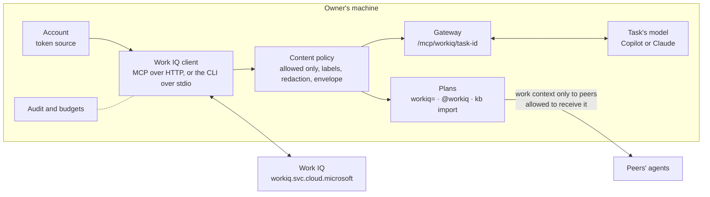

# Work IQ in Proofkin: Microsoft 365 work context (design)

Status: designed, being built with Proofkin. Tracked in
[#36](https://github.com/mcbelton/proofkin/issues/36), one sub-issue per piece of work (see
[Work items](#work-items)). Until an item is closed, what it describes doesn't exist yet.

## Why

The decisions and requirements behind code live in Microsoft 365: specs in Word and
SharePoint, decisions in meetings, threads in Teams and mail. [Work
IQ](https://learn.microsoft.com/en-us/microsoft-365/copilot/extensibility/work-iq/mcp/overview)
is Microsoft's service that lets an agent search and ask about that data as the signed-in
person, under the tenant's permissions, sensitivity labels and policies. With it, a plan can
start from what the team actually decided, and a task can look things up while it works.

Two things make this more than another MCP server:

- **Proofkin is peer to peer.** Peers can belong to other people and other companies, so
  work data has to stay with the person it belongs to unless they decide otherwise.
- **Work IQ is per person and costs money.** It runs on the owner's delegated sign-in (there
  is no app-only access) and bills Copilot Credits per call.

## What Work IQ offers

| | |
| --- | --- |
| MCP endpoint | `https://workiq.svc.cloud.microsoft/mcp` (streamable HTTP). Its metadata (`/.well-known/oauth-protected-resource/mcp`) names the authority `https://login.microsoftonline.com/organizations/v2.0` and the scope `WorkIQAgent.Ask`. |
| A2A endpoint | `https://workiq.svc.cloud.microsoft/a2a` (A2A 1.0 with `A2A-Version: 1.0`); agent cards at `/a2a/.well-known/agent-card.json`. |
| Tools | `retrieve` (cited search over mail, meetings, files, Teams, people and connectors), `ask` (an answer from Microsoft 365 Copilot or a declarative agent), `fetch`, `fetch_blob`, `search_paths`, `get_schema`, `list_agents`, `discover`. Changes: `create_entity`, `update_entity`, `delete_entity`, `do_action`, `call_function`. `tools/list` is the source of truth. |
| Permissions | Delegated only, each needing admin consent: `WorkIQAgent.Ask` (ask agents; reads *and* writes), `WorkIQ.Read`, `WorkIQ.Act`. Resource `api://workiq.svc.cloud.microsoft` (app id `fdcc1f02-fc51-4226-8753-f668596af7f7`). |
| Tenant setup | The resource's service principal, a client app registration with admin consent, usage-based billing with a spending policy covering the users, and the Work IQ MCP policy (changes are blocked by default; policy changes take up to 24 hours). |
| CLI | [`@microsoft/workiq`](https://github.com/microsoft/work-iq) (npm): `workiq mcp` is a local stdio MCP server that signs in by itself with Microsoft's Work IQ CLI app. |

Retrieval results are in `structuredContent["application/vnd.ms-workiq.retrieval"].results`
(the MCP `content` array can be empty): each has `markdown` with `[^h1]` citations, `webUrl`,
`entityType`, `resourceMetadata`, `sensitivityLabel` and `contentProtection`. Only
`contentProtection: "allowed"` is an allow decision; a missing, failed, blocked or unknown
value is not. A call failed if it has `isError: true` or `stoppedReason: "error"`, possibly
with `errorCode`, `recoveryAction` and `retryAfterSeconds`. Policy denials must not be retried.
`ask` is different: its answer is the text `content`, and `structuredContent` holds only the
`conversationId` (the Work IQ CLI 1.0.1 says so in its tool list).

Each tool carries MCP annotations (`readOnlyHint`, `destructiveHint`): in the CLI 1.0.1,
`retrieve`, `fetch`, `fetch_blob`, `search_paths`, `get_schema`, `discover` and
`call_function` are read only, `create_entity` isn't, and `update_entity`, `delete_entity`
and `do_action` are destructive. `ask` and `list_agents` have none. The CLI also offers
`accept_eula` and `get_debug_link`, which need the user's own confirmation.

## Principles

1. **Delegated, per person.** Work IQ runs as the profile's owner, signed in with their work
   account. Tokens stay in the OS credential store and the agent's memory: never in prompts,
   tool arguments, logs or messages to peers. A digital worker uses its owner's account only
   if the owner turns that on.
2. **Context, never proof.** Work IQ content is cited and unverified. It can shape a task; it
   can't prove a claim. Only checks do.
3. **Work data stays with its owner.** Microsoft 365 content goes only to the owner's own
   agent and digital workers, unless the owner allows a peer to receive it, within the
   sensitivity labels they choose. Anything made from it (a step's output, a knowledge
   topic) carries that origin.
4. **Fail closed.** Only results Work IQ marks `allowed` are used, labels the owner didn't
   allow are withheld, and denials are reported with who can fix them, never retried.
5. **Read by default.** Changes (send mail, post in Teams, edit a file) need the tenant's
   policy, the owner's opt-in and a sign-off on the exact operation, and run once.
6. **Visible cost.** Every call is audited (without its text) and counted against daily and
   per-run budgets.
7. **Never in the way.** Without a Work IQ sign-in nothing changes. A Work IQ problem fails
   only the step that needs it, and says how to fix it.

## Architecture



### 1. Account and sign-in

A profile gets a Work IQ account next to its provider sign-ins (`profile.json`, key `workiq`),
with one of two connections:

- **Hosted** (default): Proofkin signs in to Entra ID itself and calls the hosted endpoint.
  - The organization registers its own client app, as Microsoft asks (don't reuse a published
    plugin's or the CLI's client id): a public client (Mobile and desktop platform, redirect
    `http://localhost`, public client flows on for device codes) with the delegated
    `WorkIQAgent.Ask` permission and admin consent.
  - `proofkin auth login workiq --tenant <id-or-domain> --client-id <app-id> --profile P`:
    authorization code with PKCE (S256) on a loopback redirect (`http://localhost:<free
    port>`; the browser opens), or `--device-code` for headless agents.
  - Scopes `api://workiq.svc.cloud.microsoft/WorkIQAgent.Ask offline_access openid profile`,
    on the tenant's own authority (`login.microsoftonline.com/<tenant>/v2.0`), without a
    `resource` parameter (Entra rejects the MCP URL as a resource).
  - The refresh token is in the secret store (`<profile>/workiq`), replaced on every refresh.
    The access token lives in memory and is refreshed 5 minutes before it expires. A claims
    challenge (Continuous Access Evaluation) or `invalid_grant` asks the owner to sign in
    again.
- **CLI**: Proofkin starts Microsoft's Work IQ CLI (`workiq mcp`, else `npx -y
  @microsoft/workiq mcp`) and speaks MCP to it over stdio; the CLI signs in by itself and
  picks the tenant from its account. For tenants that approved the Work IQ CLI app:
  `proofkin auth login workiq --cli [--account <email>] [--cli-path <path>]`. The sign-in
  finds the CLI (on the PATH, else in npm's global folder, which a Node version manager keeps
  off the PATH) and saves where it is, so agents start the same one; `--account` is passed
  to `workiq mcp --account`. Proofkin never accepts the CLI's EULA for the owner; it tells
  them to run `workiq accept-eula`.

`proofkin auth status` shows the account (user, tenant, connection, token expiry) and
`proofkin auth logout workiq` deletes its token. A digital worker gets its owner's Work IQ
account only when the owner turns it on for that worker.

### 2. Client

`src/workiq/` speaks MCP to Work IQ: `initialize` (keeping `Mcp-Session-Id`, and starting a
new session when the server forgets it), `tools/list` (cached; a missing tool is a clear
error) and `tools/call`, with JSON or SSE replies. It has typed calls for `retrieve`, `ask`,
`fetch` and `list_agents`. Every request sends a `client-request-id`, and the response's
request and correlation ids go into the audit and into error messages, so admins and support
can find the call. HTTP goes through `reqwest`, already in the dependency tree through iroh.

Errors are classified, and only the safe ones are retried:

| Class | Seen as | Proofkin does |
| --- | --- | --- |
| Sign in again | 401 after one silent refresh, `invalid_grant`, a claims challenge | Fails, naming `proofkin auth login workiq` |
| Consent | `AADSTS65001`, `consent_required` | Fails with the admin consent steps |
| Denied by policy | 403, a policy `errorCode` or `recoveryAction` | Fails with who can change it and where; never retried |
| Billing | spending policy errors | Fails with the billing steps |
| Throttled | 429, `retryAfterSeconds` | Waits as told (at most 60 s, twice), else fails |
| Transient | 5xx and timeouts on read tools | Backs off with jitter, at most twice |
| Uncertain change | a change that timed out | Reported as uncertain; never sent again |

Only the read tools (`retrieve`, `ask`, `fetch`, `fetch_blob`, `search_paths`, `get_schema`,
`list_agents`, `discover`) are sent again after a throttle or a transient failure. A change
tool, or any tool not in that list, is sent once; the one exception is a 401, which is
rejected before it runs, so it is sent once more after the token is refreshed. Each error
has a class, a fix (what to do and who can do it) and the ids, and its message is one line.

### 3. Content policy

Every result goes through one function before it reaches a prompt (`src/workiq/content.rs`):

1. Read `structuredContent`, never the `content` array (except an `ask` answer's text,
   which Work IQ gives only there).
2. Keep only `contentProtection: "allowed"`. Count the rest as withheld, by reason.
3. Filter by the audience's labels. The owner's own agent and digital workers get every label;
   a peer gets only the labels the owner allowed for it (`unlabeled` is one of the choices).
   Labels are names each tenant defines, so the rule is an allowlist, not a ranking. A
   result without label information (no `sensitivityLabel`) has an unknown sensitivity, so
   it goes to no peer; Work IQ marks unlabeled content with an empty one.
4. Redact secrets (`redact`), cap the size (highest relevance first, 16 000 characters by
   default) and wrap each result in the external-content envelope (`boundary`) with its
   source: title, type, date, label and link.

The prompt section says what it is: *Work context from Microsoft 365 (Work IQ). Cited and
unverified: use it to understand intent, not as proof.* `ask` answers are handled the same
way: their citations decide their labels, and an answer without citation metadata stays
local.

### 4. Data boundary

- **Grants per peer**, in the allowlist (`peers.json`), off by default. `proofkin peers allow
  <peer> --m365 General,Public,unlabeled` lets that peer receive work context with those
  labels; `--m365-tools` lets its tasks use this agent's Work IQ through the gateway (read
  only); `--m365 off` removes both.
- **Origin**: content from Work IQ is marked, and so is everything made from it: a step that
  got work context or used the gateway, its output, a `@workiq` step's answer, and a
  knowledge topic imported or saved from them (front matter `origin: workiq` and `labels:`).
  Dependents (`after`) and `context=` inherit the mark. A step's mark is the union of the
  labels it got (`Step.m365`; the `workiq=` option and `@workiq` steps set the same field);
  a mark without labels counts as `unlabeled`.
- **Checked twice**: the plan check fails a step that would send marked content to a peer
  without a grant, or above its labels, naming the step, the peer and the grant to add. The
  runner checks again when it sends each task, and filters by labels then.

### 5. Work context in plans

- **`workiq=SOURCES`** on a step (`all`, or some of `email`, `meetings`, `files`, `teams`,
  `people`, `connectors`): when the step starts, its plan's agent runs `retrieve` with the
  step's task as the query, for the step's audience, and puts the result in front of the
  prompt. `connectors` uses the `copilot` strategy, the rest `grounding`.

  ```text
  spec @worker:app workiq=meetings,files Write the retention spec the November design reviews agreed on
  ```

- **`@workiq` steps** ask Work IQ (`ask`), or a declarative agent with `agent=<id>`
  (`proofkin workiq agents` lists them), as part of a plan. The answer is the step's output:
  cited context, never proof, so a `@workiq` step can't have `claims=`, `verify=` or
  `apply=`. It works with `save=` and `after`.

  ```text
  decisions @workiq save=retention-decisions What did we decide about invoice retention in November?
  build after decisions @worker:app context=retention-decisions verify=test claims=RET-1 Implement the agreed retention rules
  ```

- **Knowledge import**: `proofkin kb import workiq <topic> --query "..." [--from
  meetings,files]` keeps cited work context as a topic (with its origin, labels, query and
  date) for `context=`.
- **Evidence**: the local run record keeps each call's sources, withheld counts and ids. The
  signed evidence, which can be shared, keeps only a hash of the context, the number of
  results and their labels.
- **Specs from documents** (later): `proofkin spec import --from <SharePoint or OneDrive
  URL>`.

### 6. Work IQ as a tool for tasks (gateway)

A task's model can also call Work IQ while it works, through a local gateway rather than a
token:

- A folder offers it like its other MCP servers (`proofkin mcp add <folder> workiq
  --workiq`), and a step asks for it (`mcp=workiq`).
- For each task the agent opens `http://127.0.0.1:<port>/mcp/workiq/<task>` with a random
  per-task bearer, closed when the task ends. The model's MCP config points there and the
  gateway adds the owner's fresh token, so long tasks keep working and the model never sees
  the token.
- Only read tools by default (`retrieve`, `ask`, `fetch`, `search_paths`, `get_schema`,
  `list_agents`), and never one whose annotations say it changes things, whatever its name.
  Every result goes through the content policy for the task's audience;
  every call is audited and metered; sizes are capped.
- The server is called `workiq`, so a plan knows a step with `mcp=workiq` reads Microsoft
  365 content whose labels it never learns: the step is marked `unknown`, and nothing made
  from it goes to a peer.
- Peers' tasks get it only with the `--m365-tools` grant, within that peer's labels. Codex
  tasks can't use MCP servers, so they can't use it either.

### 7. Changes in Microsoft 365

Change tools (`create_entity`, `update_entity`, `delete_entity`, `do_action`, and
`call_function`s that write) are off unless the folder's `workiq` server allows them. Then
each call stops and becomes a sign-off in the web UI, like a plan's `approve` step, showing
the exact operation (path, recipients, a preview of the body). Approved, it runs once and the
model gets the observed outcome; a 202 is reported as accepted, not done. The tenant's policy
still applies, and blocks changes by default. Later: sign-off requests in Teams or mail, if
the owner opts in.

### 8. Plugins and enterprise skills

Adding Microsoft's Work IQ plugin (`microsoft/work-iq`, `plugins/workiq`) keeps its skills
and maps its MCP server (the hosted URL, or `@microsoft/workiq`) to the agent's own `workiq`
server: Work IQ through the agent's sign-in and gateway (section 6), never the plugin's own
connection or sign-in settings. Later: find the organization's
skills and plugins with Work IQ's `discover` and add them through the usual plugin review.

### 9. Audit, usage and budgets

Every call is a line in `<profile>/workiq-audit.jsonl`: time, tool, purpose (a run's step,
knowledge import, a gateway task, doctor), audience, the query's SHA-256 and length (not its
text), outcome class, results and withheld counts, labels, request and correlation ids, and
duration. Budgets in `profile.json` (`workiq_budget.calls_per_day`, default 200;
`workiq_budget.calls_per_run`, default 25) stop calls with a clear error before they are
sent, and the call is audited as refused; `proofkin workiq usage` and `proofkin workiq
budget` show and change them. The web UI shows today's
use.

### 10. Diagnostics and the web UI

`proofkin workiq doctor` checks, in order: discovery, the sign-in, the token's audience,
tenant and scopes, `tools/list`, and one small `retrieve`. Each failure names the fix and who
can make it (service principal, consent, user assignment, billing, MCP policy). The web UI
gets a Work IQ card in Accounts (sign in with a device code shown in the page, status, doctor,
use against budgets), Microsoft 365 grants on peers, `workiq=` and `@workiq` in the plan
editor, an import in Knowledge, and the sources a step used in its run.

## Threat model

| Threat | Mitigation |
| --- | --- |
| Instructions hidden in mail, chats or documents (prompt injection) | Work IQ's own sanitization (preview), plus Proofkin's external-content envelope and standing rule. Content never approves a tool. Changes need a person's sign-off. |
| Work data leaking to peers | Grants per peer, off by default; label allowlists; origin follows outputs and knowledge; checked at the plan check and again when sending; audited |
| A peer using my agent to read my Microsoft 365 data | `--m365-tools` per peer, read only, budgets, audit |
| Token theft | Secret store and memory only; JWTs redacted from output; per-task gateway bearers on 127.0.0.1, revoked when the task ends |
| Runaway cost | Budgets per day and per run; every call counted |
| Retry storms, repeated changes | Classified errors; denials and changes never retried; the server's delays honored |
| Stale or wrong context taken as truth | Cited, dated and marked unverified; claims are proven only by checks |

## Admin setup (summary)

1. Enable Work IQ in the tenant: create the resource's service principal (`az ad sp create
   --id fdcc1f02-fc51-4226-8753-f668596af7f7`).
2. Register a client app (single tenant; Mobile and desktop platform; redirect
   `http://localhost`; public client flows allowed), add the delegated `WorkIQAgent.Ask`
   permission from Work IQ, grant admin consent, turn on "Assignment required" and assign the
   users.
3. Set up usage-based billing and a spending policy covering those users and the Work IQ API.
4. Review the Work IQ MCP policy (Microsoft 365 admin center, Agents, Tools): reads on,
   changes off unless needed.
5. For the CLI connection instead: grant admin consent to the Work IQ CLI app (see
   Microsoft's [Work IQ repository](https://github.com/microsoft/work-iq)).

The step-by-step guide, with a check after each step and troubleshooting, is in the README:
[Microsoft 365 work context (Work IQ)](../README.md#microsoft-365-work-context-work-iq).

## Testing

- Tests against a fake Work IQ server (sessions, SSE, `structuredContent`, every error class,
  delays), fake Entra endpoints, and a fake stdio server for the CLI connection.
- The commands through the program itself (`tests/workiq_e2e.rs`): sign-in, `workiq doctor`,
  `workiq agents`, `kb import workiq`, and a plan's `@workiq` and `workiq=` steps run by
  `proofkin`'s own agent, against the fakes. The test-only settings
  `PROOFKIN_TEST_WORKIQ_URL` and `PROOFKIN_TEST_ENTRA_URL` point it at them; they take only a
  loopback address. The CLI connection is tested the same way with `--cli-path`.
- A `WIQ-*` claim in `evidence/claims.json` for each behavior above.
- A live check behind `PROOFKIN_LIVE_WORKIQ=hosted|cli` (`scripts/live_workiq.py`), for a
  tenant with Work IQ: sign-in, doctor (one `retrieve`), a `workiq=` step sent to the owner's
  own worker on real Copilot and an `@workiq` step, then the evidence and an audit that shows
  only reads. It never prints Microsoft 365 content.

## Work items

Each part is built by one or more Proofkin plans: the plan tracks the part (`track: #N`) and
each step works on one of its sub-issues (`issue=#N`).

| Part | Item | Blocked by |
| --- | --- | --- |
| [#37](https://github.com/mcbelton/proofkin/issues/37) Connect an enterprise account | [#38](https://github.com/mcbelton/proofkin/issues/38) MCP client over streamable HTTP | |
| | [#39](https://github.com/mcbelton/proofkin/issues/39) Classified errors, safe retries | #38 |
| | [#40](https://github.com/mcbelton/proofkin/issues/40) Account and token store | |
| | [#41](https://github.com/mcbelton/proofkin/issues/41) Sign-in: PKCE or device code | #40 |
| | [#42](https://github.com/mcbelton/proofkin/issues/42) The Work IQ CLI connection | #38 |
| | [#43](https://github.com/mcbelton/proofkin/issues/43) `proofkin workiq doctor` | #39, #41 |
| [#44](https://github.com/mcbelton/proofkin/issues/44) Keep work data with its owner | [#45](https://github.com/mcbelton/proofkin/issues/45) Content policy | |
| | [#46](https://github.com/mcbelton/proofkin/issues/46) Grants per peer | |
| | [#47](https://github.com/mcbelton/proofkin/issues/47) Origin and plan checks | #45, #46 |
| | [#48](https://github.com/mcbelton/proofkin/issues/48) Audit and budgets | #38 |
| [#49](https://github.com/mcbelton/proofkin/issues/49) Work context in plans | [#50](https://github.com/mcbelton/proofkin/issues/50) `workiq=` step option | #39, #40, #45, #47, #48 |
| | [#51](https://github.com/mcbelton/proofkin/issues/51) `@workiq` steps | #50 |
| | [#52](https://github.com/mcbelton/proofkin/issues/52) Knowledge import | #40, #45, #47 |
| | [#53](https://github.com/mcbelton/proofkin/issues/53) Context in evidence | #50 |
| | [#54](https://github.com/mcbelton/proofkin/issues/54) Specs from SharePoint or OneDrive (later) | #52 |
| [#55](https://github.com/mcbelton/proofkin/issues/55) A tool for tasks | [#56](https://github.com/mcbelton/proofkin/issues/56) The gateway | #39, #40, #45, #48 |
| | [#57](https://github.com/mcbelton/proofkin/issues/57) Peers' tasks with a grant | #56, #46 |
| | [#58](https://github.com/mcbelton/proofkin/issues/58) Changes with a sign-off | #56 |
| | [#59](https://github.com/mcbelton/proofkin/issues/59) Microsoft's Work IQ plugin | #56 |
| | [#60](https://github.com/mcbelton/proofkin/issues/60) Enterprise skills through `discover` (later) | #59 |
| | [#61](https://github.com/mcbelton/proofkin/issues/61) Sign-off requests in Teams or mail (later) | #58 |
| [#62](https://github.com/mcbelton/proofkin/issues/62) Web UI, docs and release | [#63](https://github.com/mcbelton/proofkin/issues/63) Work IQ account card | #41, #43, #48 |
| | [#64](https://github.com/mcbelton/proofkin/issues/64) Grants, plan editor, import, sources | #46, #50, #51, #52 |
| | [#65](https://github.com/mcbelton/proofkin/issues/65) Docs, admin guide, claims, live check | #50, #56, #63 |

Order: the client, account, content policy, grants and audit first (none needs a tenant),
then work context in plans and the doctor, then the gateway, the web UI and the docs, with
one release and one live check for the batch. The items marked later come after that.

## Open questions

- `contentProtection` may be missing on many results today, and failing closed can then
  withhold most of them. We start strict and show withheld counts, and revisit with
  Microsoft's guidance rather than add an override.
- `@workiq` steps start with MCP `ask`. A2A (streaming, `contextId` conversations) may suit
  long answers better.
- Whether peers should share their Work IQ tenant id, so the web UI can say "same
  organization" next to a grant.
